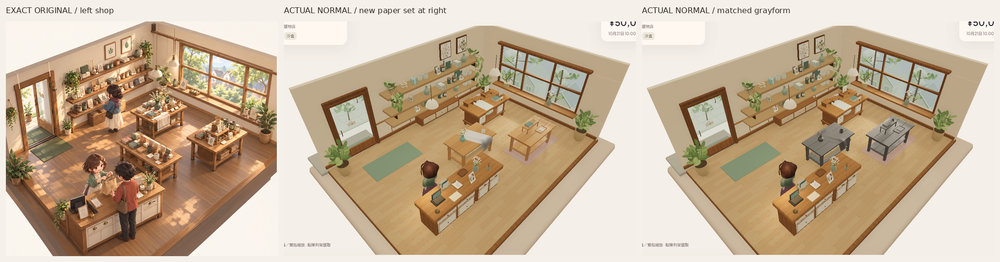

# 木層架／紙本 R2 — 分開上下層輪廓的固定候選

後續獨立覆核：**Paper R2 grouped-silhouette/layering gate PASS**。本組與R4凍結；這不是整體原圖畫風接受。下一階段另做[Misaki比例灰模](MISAKI_GRAYFORM_V1_2026-10-27_zh-HK.md)，下方保留本輪當時交審紀錄。

Source `669b5aaa97641fb597ae5e83095056d8c7ee1229`，只在`codex/asset-foundation-v1`。獨立覆核：v1單件形體暫時PASS，但**成組展示層次FAIL**。本輪只加寬層架、移開托盤／上下紙本；**R2尚未獨立判PASS，整體原圖畫風仍未接受。** R4花冠／布形／陶瓷／材質、此組薄板／開放承托／書厚／封面外伸／圓轉書脊全部保留，沒有加道具、頁線、貼圖或燈。

仍以[唯一原圖](codex-v4/reference/Approved_Visual_Target_Misaki.png)實際像素為準，1536×1024，SHA256`9f855d2ecfd120bb45c001db3fa9b5a3e3b58b2b3c2a4cf9e7ebfda84f8f7114`。對照只有裁切、等比縮放及標籤；不是重畫或修色。右桌是本輪新組，中央R4相鄰基線與舊背景不改。

## 改動及實際比例

- 層架寬580→800mm，R4桌實測寬1,860mm，因此31.18%→**43.01%**。40–45%只是試驗起點，不是從原圖量出的規格。頂高260mm、兩塊24mm板、27mm柱、bearer厚度與全部材質不變；只沿長軸延展板／橫承托，柱移到新承托位置。
- 層架／書向一側移，托盤向另一側移150mm並前移215mm；下層紙本隨托盤移。新托盤footprint與層架footprint有76.5mm前後淨距，上下紙本X bounds間距159.3mm，免於原先前後疊成中心小團。這些是幾何量，不代替實際畫面判斷。
- 書疊仍30／13／21mm，封面與圓轉binding、散頁／摺卡形材不動；**書疊、紙疊、摺卡、托盤四個獨立GLB逐byte同v1**。新三角面仍3,096，沒有增加。

[v1→R2正常材質480px](reviews/evidence/asset-foundation-paper-v1-r2/v1-r2-material-normal-game-shop480.png)／[正常灰模](reviews/evidence/asset-foundation-paper-v1-r2/v1-r2-gray-normal-game-shop480.png)；[左斜角材質](reviews/evidence/asset-foundation-paper-v1-r2/v1-r2-material-oblique-left-shop480.png)／[右斜角材質](reviews/evidence/asset-foundation-paper-v1-r2/v1-r2-material-oblique-right-shop480.png)及[左灰模](reviews/evidence/asset-foundation-paper-v1-r2/v1-r2-gray-oblique-left-shop480.png)／[右灰模](reviews/evidence/asset-foundation-paper-v1-r2/v1-r2-gray-oblique-right-shop480.png)。

## 完整實拍與固定條件

|模式|正常完整PNG|左斜角|右斜角|固定兩光|
|---|---|---|---|---|
|材質|[正常](reviews/evidence/asset-foundation-paper-v1-r2/paper-material-normal-game.png)|[左](reviews/evidence/asset-foundation-paper-v1-r2/paper-material-oblique-left.png)|[右](reviews/evidence/asset-foundation-paper-v1-r2/paper-material-oblique-right.png)|[材質](reviews/evidence/asset-foundation-paper-v1-r2/paper-fixed-light-material.png)|
|灰模|[正常](reviews/evidence/asset-foundation-paper-v1-r2/paper-gray-normal-game.png)|[左](reviews/evidence/asset-foundation-paper-v1-r2/paper-gray-oblique-left.png)|[右](reviews/evidence/asset-foundation-paper-v1-r2/paper-gray-oblique-right.png)|[灰模](reviews/evidence/asset-foundation-paper-v1-r2/paper-fixed-light-gray.png)|

實際原遊戲app normal camera alpha−π/4、beta50°、radius9.980211978、target[.7,1.15,0]，沒有zoom；兩斜角只改alpha±.24。灰／材質及v1／R2完整燈設定、作者max8lights／environment.8、scene environment1／exposure1逐值同。固定光維持key2.1／fill.65及原studio相機。新組仍同一右側作者桌位置，沒有改鏡頭令它變大。

正常縮圖的上層書疊和下層紙張現在可分開，但仍只有少量留白物件，薄層架可能偏輕／支柱感強；書紙原先較齊、卡片空白的限制保留。下一步必須先獨立判斷**同組的分層、寬高重量及上下紙本輪廓**，若未過只修這些比例，不補更多props或微紋理，也不擴整店。R4 MAIN-SHAPE PASS不等於本組或整體畫風PASS。

## 來源、驗證與限制

[可編輯blend](../assets/authoring/asset-foundation-paper-v1/paper-display-set.blend)、[組合GLB](../public/assets/asset-foundation-paper-v1/paper-display-set.glb)、[獨立件及重建說明](../tools/asset-foundation/PAPER_README.md)、[驗證摘要](reviews/evidence/asset-foundation-paper-v1-r2/summary.json)、[全TRS／支承／六GLB驗證](reviews/evidence/asset-foundation-paper-v1-r2/asset-validation.json)、[原始capture紀錄](reviews/evidence/asset-foundation-paper-v1-r2/capture.json)。

- 新組3,096tri，5meshes／9materials／14primitives／7重用圖頁；組合GLB645,596bytes。再用測試桌6,480tri、相鄰R4 62,120tri，原型合計71,696tri；不bulk複製，原花LOD限制保留。
- 本輪重跑Blender生成、六GLB皆零error／warning、contact／支承footprint／托盤開口／四獨立件bytes及R4全部21檔bytes保護、最終build。書／卡對層架接觸差約−6.75e−9／+8.03e−9m，紙對托盤底+1.04e−10m，底Y0。這是bounds支承檢查，非完整collisionproof。
- 原application720個保護檔逐byte保留；前checkpoint302tests／contentvalidate／replay／legacyassetcheck通過，本輪沒有重跑不測這些新比例的app tests，沒有冒稱新302次結果。
- 本輪fresh Sandbox真UI買三杯cash5000→4790、stock3、未改原display3／槽2上架，reload逐值同、Low→High保留、隔離Normal不變；0pageerror。實際灰／材質載入GLB bytes與source同。新組仍是作者裝飾，沒有生產stock槽高整合／新SKU。
- Chromium SwiftShader靜態證據不是實體GPU／FPS／audio／native／新完整五語UI或美術接受。

原生Library正常實拍更新同一image `libfile_b2eae1dd4f888191863e3d6eac738404`，**paper-material-normal-game.png version1**，file ID`file_00000000125c8211b68e0cfe2119597a`，639,882bytes；v1原version0及R4獨立第5版保留。

PR建立仍沿先前拒絕停止，無retry／換route；main／PR8／merge／Site公開／payments／玩家Normal未改，無其他操作阻塞。沒有角色匯入或全店組裝。
