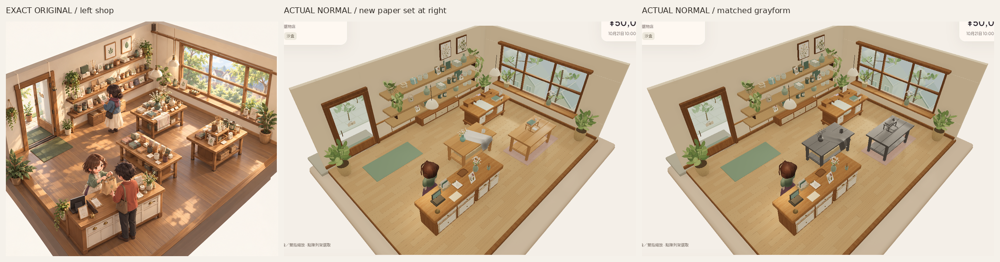

# 木層架／紙本基礎 v1 — 首個固定候選

後續獨立覆核：單件形體暫時PASS，**成組展示層次FAIL**。下方保留首候選證據；只修比例／擺位的後續見[紙本R2](ASSET_FOUNDATION_PAPER_R2_2026-10-27_zh-HK.md)，未擴整店。

來源：`c16461fab229b4054575bcee5b956c339bfaf94f`，獨立分支 `codex/asset-foundation-v1`。R4 經獨立覆核 **MAIN-SHAPE PASS**，本輪將其花冠、布形、陶瓷及木材全部凍結，只新增開放式木層架／淺托盤與不同厚度的書、紙、摺卡。**新組仍待獨立風格覆核；整體原圖畫風未被接受。** 沒有擴整店、角色、燈光或商品系統。

原圖仍是 [Approved_Visual_Target_Misaki.png](codex-v4/reference/Approved_Visual_Target_Misaki.png)，1536×1024，SHA256 `9f855d2ecfd120bb45c001db3fa9b5a3e3b58b2b3c2a4cf9e7ebfda84f8f7114`。已重新看實際像素及右側桌面／書疊區域。上圖只有裁切、等比縮放及標籤；完整實拍保留，沒有修色、重畫或假陰影。中間桌是凍結 R4，右桌是本輪新組，舊背景不屬本輪重建成果。

## 對應原圖的形體選擇

- 原圖層架是有空隙、薄板與細承托的實物，本輪做兩塊24mm板、四根27mm柱、承托橫料的開放層架；不用實心樓梯塊。上層頂高260mm，寬580mm。獨立托盤460×270mm，有12mm底與9mm邊，不是印在桌上的平面。
- 三本書厚30／13／21mm，封面尺寸305×225、285×205、300×215mm；奶油紙體、實際連續圓轉U形書脊及封面外伸分開建模。微小不等位移／轉角使層疊可辨，沒有靠更多頁線或貼圖解析度撐細緻度。
- 紙塊130×180×20mm，加三張0.65mm實體散頁；摺卡85×118mm、0.8mm厚，兩面連續轉折。克制鼠尾草、淡陶粉、燕麥封面與暖奶油紙色，木材直接重用 R4 資料與貼圖。

這些是從原圖形體語言推導的作者尺寸，並非能由插畫精確量出的實物規格。固定光可辨層次與空隙，但正常480px下新組仍小、疏，書紙邊緣偏整齊，摺卡空白亦較抽象。**下一個必要判斷是正常／斜角中層架的高度重量、薄邊與書疊的柔和比例是否可信**；若未過，只修同組比例與堆疊，不用塞滿整店或加紋理掩飾。不能以順滑或驗證通過當畫風接受。

## 實際遊戲證據

|模式|正常完整PNG|斜角一|斜角二|
|---|---|---|---|
|材質|[正常](reviews/evidence/asset-foundation-paper-v1/paper-material-normal-game.png)|[左](reviews/evidence/asset-foundation-paper-v1/paper-material-oblique-left.png)|[右](reviews/evidence/asset-foundation-paper-v1/paper-material-oblique-right.png)|
|灰模|[正常](reviews/evidence/asset-foundation-paper-v1/paper-gray-normal-game.png)|[左](reviews/evidence/asset-foundation-paper-v1/paper-gray-oblique-left.png)|[右](reviews/evidence/asset-foundation-paper-v1/paper-gray-oblique-right.png)|

補充 [固定兩光材質](reviews/evidence/asset-foundation-paper-v1/paper-fixed-light-material.png)／[灰模](reviews/evidence/asset-foundation-paper-v1/paper-fixed-light-gray.png)，不替代正常鏡頭。遊戲仍原camera alpha−π/4、beta50°、radius9.980211978、target[.7,1.15,0]；斜角只改alpha±.24，beta／radius／target不變。灰／材質全燈設定逐值相同，所有作者材質max8lights／environmentIntensity.8，scene environment1／exposure1。固定光沿用key2.1／fill.65與原studio相機；沒有調光補形。

新組放在原display1位置的一張重用 R4 桌，root[-2,.079,-1.5]、yawπ，組件底在桌面localY=.905。中央 R4 保留，沒有複製花／布。只在獨立DEV作者頁排除對應舊桌及裝飾，普通 `/` 不載入這些作者頁。新件是可重用幾何／材質原型，未當存貨／SKU；新桌與中央作者桌的生產上架槽高度整合仍在後續範圍，沒有冒稱可直接採用。

## 資產與成本

可編輯 [Blender來源](../assets/authoring/asset-foundation-paper-v1/paper-display-set.blend)、[manifest](../assets/authoring/asset-foundation-paper-v1/manifest.json)、[組合GLB](../public/assets/asset-foundation-paper-v1/paper-display-set.glb)、[重建／作者頁說明](../tools/asset-foundation/PAPER_README.md)。每個獨立件實際轉換後最低Y=0；單位m，標準glTF Y-up。

|GLB|三角面|
|---|---:|
|[tiered-riser](../public/assets/asset-foundation-paper-v1/tiered-riser.glb)|864|
|[shallow-tray](../public/assets/asset-foundation-paper-v1/shallow-tray.glb)|540|
|[book-stack](../public/assets/asset-foundation-paper-v1/book-stack.glb)|1,224|
|[paper-stack](../public/assets/asset-foundation-paper-v1/paper-stack.glb)|432|
|[folded-card](../public/assets/asset-foundation-paper-v1/folded-card.glb)|36|
|新組合計|**3,096**|

組合GLB645,620bytes、5meshes、9materials、14material primitives、7嵌入圖頁（重用木材）。實際場景重用同名木材，處置重複匯入材質與圖頁；沒有新增紋理解析度。新增測試桌6,480tri，連原R4 62,120tri，作者原型總71,696tri；沒有bulk複製，原花未有LOD的限制保留。

## 實際驗證及界限

[摘要](reviews/evidence/asset-foundation-paper-v1/summary.json)、[六GLB驗證](reviews/evidence/asset-foundation-paper-v1/asset-validation.json)、[原始場景／燈相機／生命週期紀錄](reviews/evidence/asset-foundation-paper-v1/capture.json)。

- Blender4.3.2生成，strict作者TS、302既有tests、最終build、contentvalidate／replay／legacy asset-check通過；[tests](reviews/evidence/asset-foundation-paper-v1/tests.log)、[build](reviews/evidence/asset-foundation-paper-v1/build.log)。既有bundle大小提示仍在，沒有把它當裝置效能認證。
- 六新GLB皆零error／warning；書／卡與層架真位置接觸差約−6.75e−9／+8.03e−9m、紙與托盤底+1.04e−10m；支承footprint及托盤內開口亦檢查。這是bounds關係，非完整碰撞證明。
- R4全部21個資產／作者檔逐byte凍結在`70746f7269bf4b1ac27e1eed87146532cf413866`；原application720個來源／素材／設定逐byte同`78fbae7f519e4c443d5971bb18208e1c4f9de64e`。
- 灰／材質實際載入GLB的SHA256皆`0736989bcce2eec5dc196788ff2b68c4adefb0852cfe1033d24676eca94134b6`，與source相同。0pageerror。fresh Sandbox真UI買三杯cash5000→4790、stock3，在未改的原display3／slot2上架；reload保存逐值同、Low→High仍ready、fresh隔離Normal不變。沒有玩家Normal寫入。
- 這是Chromium SwiftShader靜態雲端畫面，不是實體GPU／FPS／audio／native或完整新五語UI驗收；沒有用test數接受美術。

正常完整實拍另存為**新的**原生Library image：`libfile_b2eae1dd4f888191863e3d6eac738404`，`paper-material-normal-game.png`，version0，file ID`file_000000009f2c8211a56f6fc869709de6`，639,292bytes。R4舊Library第5版未被替換。

PR建立仍因先前拒絕而停止，未retry／換route。只推送隔離分支；main／PR8／merge／Site公開版／payments／玩家Normal不變。無其他操作阻塞。[Misaki參考交接](MISAKI_NEXT_STAGE_REFERENCE_HANDOFF_2026-10-27.md)保留，這輪沒有匯入或建模角色。
