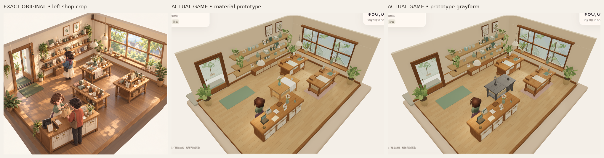
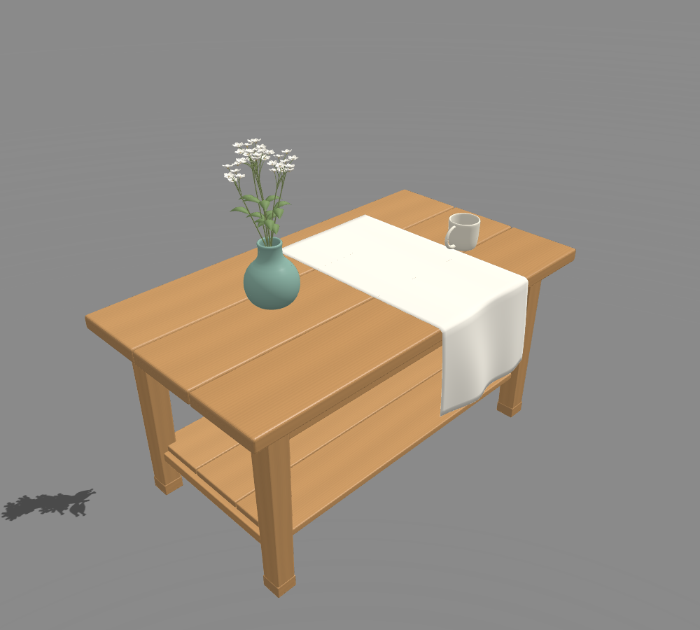

# 部件風格修正 R2 — 固定候選，畫風未接受

> 歷史R2，獨立STYLE門檻FAIL。幾何／接觸保留，後續同組修正在[R3候選](ASSET_FOUNDATION_R3_2026-10-27_zh-HK.md)。本頁原始證據與來源commit不改。

最終部件來源：`9c8104038fd78c9f7ababa9cc56e2f0c32c032c1`（包含風格／接觸修正 `08db124e54c5b03184338d3764faa77ebcaab6e9`）。只在 `codex/asset-foundation-v1` 延續原五個部件，不擴展整店或角色。**這組仍不是目標畫風 PASS；以下技術檢查不能代替美術接受。**

已重新查看[唯一完整原圖](codex-v4/reference/Approved_Visual_Target_Misaki.png)實際像素：1536×1024，SHA256 `9f855d2ecfd120bb45c001db3fa9b5a3e3b58b2b3c2a4cf9e7ebfda84f8f7114`。仍以左店景為方向；新角色圖包沒有匯入此部件組。對照圖只裁切／等比縮放／排列／標籤，沒有修色、重打光或重畫截圖。[上一組材質正常實拍](https://github.com/wizardkeith/KeEv-games/blob/72cc2cab0195b32dbed7a42c889ca8d0a4fc3d5f/docs/reviews/evidence/asset-foundation-v1/material-normal-game.png)保留。

## 三項可觀察的風格差異及改動

|與原圖的差異|本輪只改這個代表組|
|---|---|
|白花呈放射長莖／疏散白點，欠主次連續輪廓|保留35花頭／175花瓣／七主莖，重排為20／10／5的重疊主簇、較低前簇與側簇；高位接枝及縮短露莖，不以更多花瓣或三角形補密度。|
|布像重複直條窗簾褶，欠寬轉折與重量|移除週期正弦褶；兩個不等寬、會側移及改深度的大折面，加一較小肩折和不齊下擺。保留連續桌面→桌邊→垂段及真2mm厚度。|
|桌形薄／扁、木面均勻偏棕|寬1.86m及高.905m保留，深.875→1.037m、頂板52→62mm、腳柱87→102mm，配合加深圍板／下層承托；木色轉蜂蜜暖色、木紋依板與腳的長軸走向，端面獨立端紋，加入克制roughness變化。紋理仍512px，沒有提高解析度。|

這些尺寸是為輪廓作的作者選擇，並非從插畫恢復的真實尺度。杯瓶的連續曲線、內腔、rim、handle、原奶油白／青瓷材料保留，作同組較穩定的形狀與色彩基準。

## 真正接觸與相同受光條件

[GLB實測](reviews/evidence/asset-foundation-v1-r2/contact-and-budget.json)讀取最終 POSITION 和完整節點TRS／matrix，沒有從陰影推算：桌腳minY=0；桌面Y=.905000012m；杯底差−2.24e−8m、瓶底差−4.84e−8m，均在1µm門檻內。杯瓶獨立GLB的底部也回到局部0。遊戲預覽rootY=.079，對上既有floorY=.079。修的是資產原點／擺位，沒有加陰影遮浮空。

杯瓶POSITION／NORMAL／index stream fingerprint與第一版逐byte相同，只有接觸節點位移改變。中途固定光實拍發現布轉邊仍穿木面，因此以實際11mm桌邊圓角重設連續12.5mm布中面轉彎。對實際厚布三角形的52,640個頂點／邊中點／重心樣本，三塊圓角桌板的最小clearance約1.005mm；同一檢查能檢出[中途來源08db124](reviews/evidence/asset-foundation-v1-r2-interim/README.md)的−2.285mm交疊。這是採樣支撐檢查，**不是任意網格的完整碰撞認證**；中途原圖另存，沒有當作最終證據。

第一版灰模max4lights／environment1，材質max8／.8，**不能用作嚴格材質A/B**。R2所有新部件材質與灰材質均明設maxSimultaneousLights=8、environmentIntensity=.8；scene environment=1、exposure=1，原店燈光不改。capture逐值比較完整燈名／類型／intensity／enabled、每個實際material設定及正常camera，全部相同。灰模的統一albedo／roughness和取消glaze是形體閱讀本身，不是補光。

## 原始實拍與重用檔

|同一正常遊戲app|正常shop camera|實際引擎斜角一|實際引擎斜角二|
|---|---|---|---|
|材質|[完整PNG](reviews/evidence/asset-foundation-v1-r2/material-normal-game.png)|[完整PNG](reviews/evidence/asset-foundation-v1-r2/material-oblique-left.png)|[完整PNG](reviews/evidence/asset-foundation-v1-r2/material-oblique-right.png)|
|灰模|[完整PNG](reviews/evidence/asset-foundation-v1-r2/gray-normal-game.png)|[完整PNG](reviews/evidence/asset-foundation-v1-r2/gray-oblique-left.png)|[完整PNG](reviews/evidence/asset-foundation-v1-r2/gray-oblique-right.png)|

正常camera沒有zoom／Zen替代；斜角明示設為原alpha±.24 radians，beta／radius／target保留。原HUD及原場景保留，只在專用DEV頁替換中央示範桌與其舊裝飾三角形。普通遊戲 `/` 不載入作者程式，示範組不是玩家商品或存貨。

[固定中性兩光灰模](reviews/evidence/asset-foundation-v1-r2/fixed-light-gray.png)。與前輪同key2.1／fill.65、相同studio相機；沒有調燈救材質。這是同GLB的另一個Babylon場景，不是概念圖。亮布桌面在這個固定studio條件下仍有高值飽和限制，應同看遊戲灰模／材質。

- [Blender原檔](../assets/authoring/asset-foundation-v1/display-set.blend)、[重建來源](../tools/asset-foundation/build.py)、[使用方法](../tools/asset-foundation/README.md)。
- 可獨立載入的[桌](../public/assets/asset-foundation-v1/table.glb)、[杯](../public/assets/asset-foundation-v1/cup.glb)、[瓶](../public/assets/asset-foundation-v1/vase.glb)、[花](../public/assets/asset-foundation-v1/flowers.glb)、[布](../public/assets/asset-foundation-v1/cloth.glb)及[整組](../public/assets/asset-foundation-v1/display-set.glb)。標準glTF PBR／米／RH Y-up，無自訂shader或影片平面。
- 最終62,120tri，比前版少1,472；花33,124／桌6,480／杯6,548／瓶8,448／布7,520。只省去布邊不可讀的小bevel，2mm閉合布體保留。五component meshes／12material primitives。尚無LOD，花仍佔過半成本，不能整店大量複製。

## 實際驗證、限制及下一步

[完整capture及逐值受光／camera核對](reviews/evidence/asset-foundation-v1-r2/capture.json)、[新GLB驗證](reviews/evidence/asset-foundation-v1-r2/asset-validation.json)、[摘要](reviews/evidence/asset-foundation-v1-r2/summary.json)、[命令輸出](reviews/evidence/asset-foundation-v1-r2/checks/)。fresh302既有tests、最後build、content validate、replay、既有asset-check及作者strict typecheck通過；六個新GLB零error／warning。杯瓶指紋／接觸／預算檢查通過，720個原application來源／素材／設定bytes保留。Blender可能重排多材質buffer，未宣稱GLB逐byte可重建；兩個遊戲頁實際載入bytes均與最終提交GLB相同。

最終正常實拍已保存至Library原生image第3版（前一版第2版對應中途候選，歷史保留）。

fresh隔離Sandbox買三杯cash5000→4790／stock3／上架側桌／reload逐值相同、Low→High部件保留、隔離Normal不變、0pageerror。這不是新完整交易交接／五語窄UI／physicalGPU／FPS／audio／native認證。靜態SwiftShader圖不能證明實體效能或連續動作。

**剩餘畫風差距：** 花頭仍近似同尺寸星形，花簇可能仍太規整；布的大折面較少重複，但垂段仍偏乾淨、寬白頂面欠原圖材質轉面；木構仍較工整，與原圖溫潤、較有手作感的形狀／表面語言有距離。背景舊店景亦仍保留原有差距，本輪沒有擴展整店或用燈光掩蓋。

下一步先獨立看這個固定候選的正常480px及雙斜角，判斷三項風格改動是否可見且方向正確；如仍不足，繼續在這組調大形／比例／色塊與表面轉折，**不以加細節、貼圖解析度或更多拓撲補救**。PR建立保持停止且不是繼續工作的條件；無main／PR8寫入、merge、Site／publication、payments或玩家Normal改動。
