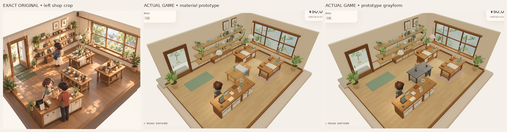
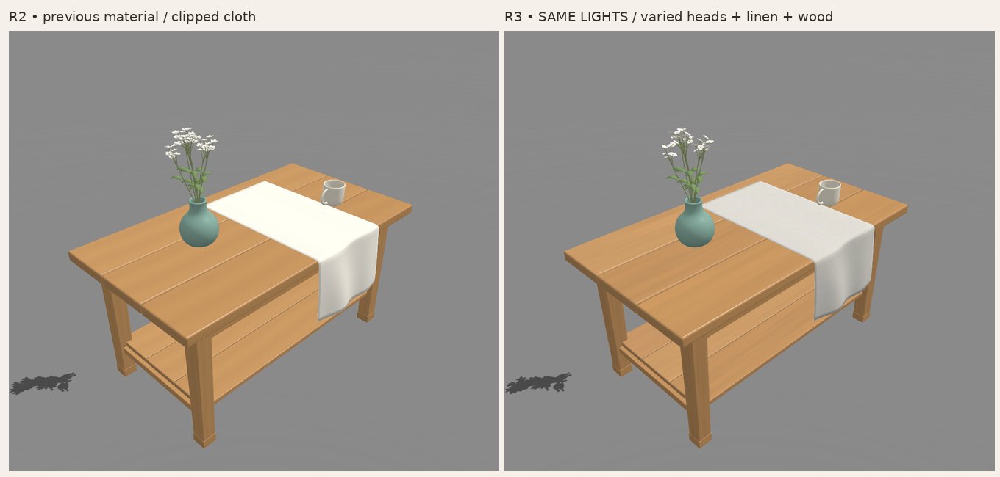

# 部件 R3 — 花頭／亞麻／自然木面候選，畫風未接受

> 歷史R3，獨立STYLE門檻FAIL：主要阻塞仍是花冠與布輪廓。[R4形狀候選](ASSET_FOUNDATION_R4_2026-10-27_zh-HK.md)保留本輪材質，釋放枝葉／花冠與布的大形；本頁原圖及來源保留。

來源：`c912b62242b9a113ec6c77f3bc0a2cf12a9f1ce4`。仍只改同五個部件；R2桌形／承托、花簇位置、布的大折面及真接觸保留。**R3只交固定候選，未判畫風PASS，不以材質數、拓撲或技術檢查代替原圖接受。**

重新按相同店景高度看[唯一完整原圖](codex-v4/reference/Approved_Visual_Target_Misaki.png)，1536×1024、SHA256 `9f855d2ecfd120bb45c001db3fa9b5a3e3b58b2b3c2a4cf9e7ebfda84f8f7114`。原圖權威不變；上圖只裁切／等比縮放／排列／標籤，沒有調色或重畫。正常相機／光照沿用原app，沒有改成studio或Zen代替全景。

## 同組三項修正

|R2仍有的人工感|R3改動與保留|
|---|---|
|近似同大／同開口／同朝向五角星|仍35花頭／175瓣，同20／10／5簇中心與全部枝葉位置；五組大小／開合，橢圓圓肩／圓端、不同杯形與朝向，讓圓白瓣重疊。沒有加花頭、花瓣或三角形。|
|布是平滑白帶，fixed-light白面剪白|保留大折面、轉邊及2mm閉合布體；加入克制的不對稱張力／下擺反應。以真正linen albedo／roughness／normal maps及不拉伸的UV閱讀亞麻，實際白反射率改為linear .66／.64／.59，所有畫面共用同材質。|
|平行條紋像工業貼皮|幾何、板／腳長軸及端紋UV、支撐全部不改；四板用不同寬疏、不等距且收斂的自然生長紋、寬方向變化及合理板色／表面差異。沒有加接縫、板厚或解析度。|

花頭大小倍率1.25／1.10／.95／1.20／.82，開口1／.82／.92／.70／.50；各7頭，分散於原簇。杯／瓶仍保留原連續曲線、內腔、rim／handle及其材質。

亞麻三張真PBR圖頁均512px，18cm重複織紋tile及微弱纖維法線；木圖頁仍512px。不是貼在截圖上的紋理，沒有影片平面或螢幕光片。加入明確glTF切線，修正新normal map的runtime-generated tangent portability警告，最終六GLB零warnings。

## 實際原圖與同光閱讀

|原遊戲app／同一正常相機|正常完整PNG|斜角一完整PNG|斜角二完整PNG|
|---|---|---|---|
|材質|[正常](reviews/evidence/asset-foundation-v1-r3/material-normal-game.png)|[斜角一](reviews/evidence/asset-foundation-v1-r3/material-oblique-left.png)|[斜角二](reviews/evidence/asset-foundation-v1-r3/material-oblique-right.png)|
|灰模|[正常](reviews/evidence/asset-foundation-v1-r3/gray-normal-game.png)|[斜角一](reviews/evidence/asset-foundation-v1-r3/gray-oblique-left.png)|[斜角二](reviews/evidence/asset-foundation-v1-r3/gray-oblique-right.png)|

灰／材質的maxSimultaneousLights8、environmentIntensity.8、scene environment1、exposure1，以及全部實際燈名／類型／強度／enabled和正常camera逐值相同。正常鏡頭沒有zoom；斜角明示使用實際相機alpha±.24，beta／radius／target保留。只有專用DEV頁替換中央示範桌和舊裝飾對應三角形，普通 `/` 不載入作者程式。

[R3原始fixed-light材質](reviews/evidence/asset-foundation-v1-r3/fixed-light-material.png)、[同兩光灰模](reviews/evidence/asset-foundation-v1-r3/fixed-light-gray.png)。仍key2.1／fill.65及原studio camera，沒有改光／曝光來解除剪白。指定布桌面ROI `(530,360)–(610,390)`：R2的R/G皆100%≥254；R3各RGB皆0%≥254，meanRGB約225.7／222.6／214.7。[原始數值與圖SHA](reviews/evidence/asset-foundation-v1-r3/material-reading.json)。這只是指定區域的LDR像素證據，非全布分割、物理反射率量度或美術PASS；studio仍不能代替正常480px全景。

正常實拍已保存Library原生image第4版；第3版R2與歷史原圖保留。

## 接觸／預算／兼容性

[實際GLB檢查](reviews/evidence/asset-foundation-v1-r3/contact-and-budget.json)保留feetY0、杯／瓶桌面差約−2.24e−8／−4.84e−8m；杯瓶POSITION／NORMAL／index streams仍與初版逐byte相同。完整節點變換的canonical triangle檢查確認R2桌形／normals／UV及枝葉位置在1µm精度不變，不靠buffer排列假定幾何保留。

布52,640個三角形頂點／邊中點／重心樣本對圓角桌板最低clearance約1.029mm；這不是完整碰撞證明。大轉彎及2mm厚度保留。整組仍62,120tri／五component meshes／12material primitives，花仍33,124tri，**未有LOD，不作整店複製**。

- [Blender原檔](../assets/authoring/asset-foundation-v1/display-set.blend)、[重建來源](../tools/asset-foundation/build.py)、[方法與驗證](../tools/asset-foundation/README.md)。
- 獨立[桌](../public/assets/asset-foundation-v1/table.glb)、[杯](../public/assets/asset-foundation-v1/cup.glb)、[瓶](../public/assets/asset-foundation-v1/vase.glb)、[花](../public/assets/asset-foundation-v1/flowers.glb)、[布](../public/assets/asset-foundation-v1/cloth.glb)及[整組](../public/assets/asset-foundation-v1/display-set.glb)。米／RH Y-up／標準glTF PBR，無新自訂shader依賴。

[完整capture](reviews/evidence/asset-foundation-v1-r3/capture.json)、[六GLB驗證及SHA](reviews/evidence/asset-foundation-v1-r3/asset-validation.json)、[保留檢查](reviews/evidence/asset-foundation-v1-r3/preservation.json)、[摘要](reviews/evidence/asset-foundation-v1-r3/summary.json)、[實際命令輸出](reviews/evidence/asset-foundation-v1-r3/checks/)。fresh302既有tests／build／content validate／replay／legacy asset-check／作者strictTS及新geometry/material contracts通過；720原application來源／素材／設定bytes不變。兩組遊戲頁載入GLB逐byte等於提交素材。Blender仍可能重排buffer，未宣稱逐byte可重建。

fresh隔離Sandbox真UI買三杯cash5000→4790、stock3／上架側桌／reload逐值同、Low→High保留、隔離Normal不變、0pageerror。這些靜態SwiftShader圖不認證實體GPU／FPS／動作／audio／native或新完整交易交接／五語窄UI。

## 剩餘畫風問題與下一步

花頭不再全是同樣尖星形，但花冠仍可能偏疏或顯得刻意排列；亞麻的明暗雖可讀，在正常遊戲鏡頭卻可能偏灰、纖維感仍弱；木面減少條帶，但整組仍較工整，距原圖溫暖手作、柔和表面語言有差距。背景舊店景亦沒有在本輪重建。**先獨立覆核這個固定候選，再判斷下一個大形／色塊／材質修正，不以更多細節補救，也不宣稱整體風格已到。**

[下一角色階段參考交接](MISAKI_NEXT_STAGE_REFERENCE_HANDOFF_2026-10-27.md)只保存Library包ID／SHA及參考規則；本輪未materialize、匯入或開始Misaki模型。PR建立保持停止，無重試或改route；無main／PR8寫入、merge、公開Site／publication、payments或玩家Normal改動。
