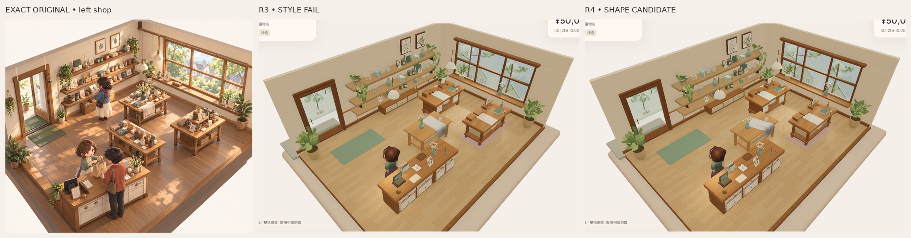
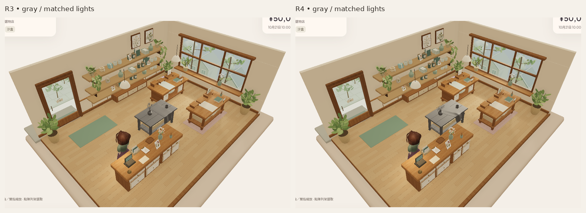
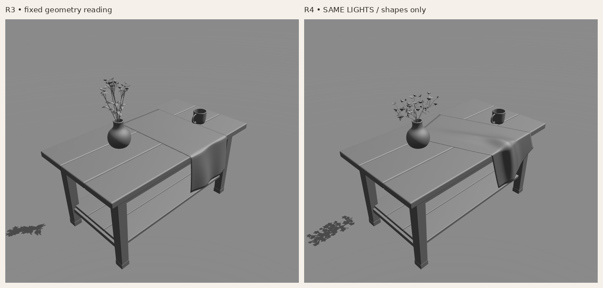

# 部件 R4 — 低寬花冠／斜向聚褶布，固定形狀候選

來源：`70746f7269bf4b1ac27e1eed87146532cf413866`。R3獨立STYLE門檻仍FAIL，本輪只重做**花枝葉連花冠**與**布的整體輪廓**，不再磨木紋／織紋。R3所有實際材質與嵌入圖頁、木桌形體／承托／UV、陶瓷形材及接觸修正保留。**R4未判畫風PASS，交固定候選獨立看形。**

[完整唯一原圖](codex-v4/reference/Approved_Visual_Target_Misaki.png)仍1536×1024，SHA256 `9f855d2ecfd120bb45c001db3fa9b5a3e3b58b2b3c2a4cf9e7ebfda84f8f7114`。所有對照只裁切、等比縮放、排列及標籤；沒有修色、重畫或替換截圖像素。背景沿用同一原app作固定背景，不把舊背景差距歸罪於新部件，也沒有擴展整店。

## 這次真正釋放的兩個形狀

**花枝葉與白冠一起重排。** 七根較低、較細的彎曲承托，配合較小、向外／下轉的葉片；35頭分佈在前後／高低交錯帶，25頭形成較密主冠，兩側各5頭形成不等翼及自然空隙。頭部白形略放大、杯形加深以增加重疊，但保留不同大小／開合／朝向；仍175瓣及原33,124tri，沒有加頭、瓣或道具。

實際GLB白瓣bounds：寬26.17→47.06cm，深17.14→19.10cm；白冠最高點下降16.25cm。白冠最低點距瓶口約24.11→11.48cm。這些只說明主輪廓的幾何變化，不等於柔白花冠的美術接受。根部仍插入原瓶，瓶口高度範圍224個實際莖頂點的最大徑向距離17.32mm，未碰原瓶口。

**布放棄直條runner。** 用一整幅.60×1.30m布面斜放20°；各材質列在不同位置到達真桌邊，因此自由邊本身斜向鬆落，而不是原直條再加細褶。桌面有一條清楚斜向受力折面，桌邊局部收攏；下段放鬆展開、弧形不齊下擺。連續桌面→圓角→垂段和真2mm厚度保留，使用原亞麻圖頁及物理尺度UV，不用normal／texture代替輪廓。

[同相機斜角一R3→R4](reviews/evidence/asset-foundation-v1-r4/r3-r4-oblique-left.png)、[斜角二R3→R4](reviews/evidence/asset-foundation-v1-r4/r3-r4-oblique-right.png)。正常camera、完整已記錄燈設定跨R3/R4逐值相同；灰／材質亦逐值相同。沒有zoom／Zen替換正常鏡頭，斜角仍實際相機alpha±.24，beta／radius／target保留。

## 原始遊戲圖與固定形狀閱讀

|同一原遊戲app|正常完整PNG|斜角一完整PNG|斜角二完整PNG|
|---|---|---|---|
|材質|[正常](reviews/evidence/asset-foundation-v1-r4/material-normal-game.png)|[斜角一](reviews/evidence/asset-foundation-v1-r4/material-oblique-left.png)|[斜角二](reviews/evidence/asset-foundation-v1-r4/material-oblique-right.png)|
|灰模|[正常](reviews/evidence/asset-foundation-v1-r4/gray-normal-game.png)|[斜角一](reviews/evidence/asset-foundation-v1-r4/gray-oblique-left.png)|[斜角二](reviews/evidence/asset-foundation-v1-r4/gray-oblique-right.png)|

[R4原始fixed-light材質](reviews/evidence/asset-foundation-v1-r4/fixed-light-material.png)、[灰模](reviews/evidence/asset-foundation-v1-r4/fixed-light-gray.png)、[唯一原圖／R4材質／灰模480px](reviews/evidence/asset-foundation-v1-r4/target-material-gray-shop480.png)。key2.1／fill.65、studio camera不改。主遊戲仍max8lights／environmentIntensity.8、scene environment1／exposure1；沒有另一次光照調參。

所有12個glTF材質定義及其實際嵌入圖頁SHA與R3相同，包含減少工業條紋的木、陶瓷和未剪白亞麻。因此本輪不是材質微調；新角度／表面法線引起的像素差異不應當成重新打光。普通 `/` 不載入作者頁，中央組只是非存貨示範，不創建新SKU／存貨。

最終正常實拍保存為Library原生image第5版；R3第4版及全部歷史證據保留。

## 原始資產、接觸與驗證

- [Blender原檔](../assets/authoring/asset-foundation-v1/display-set.blend)、[重建來源](../tools/asset-foundation/build.py)、[形狀對照產生方法](../tools/asset-foundation/shape-compare.py)、[使用／檢查說明](../tools/asset-foundation/README.md)。
- 獨立[桌](../public/assets/asset-foundation-v1/table.glb)、[杯](../public/assets/asset-foundation-v1/cup.glb)、[瓶](../public/assets/asset-foundation-v1/vase.glb)、[花](../public/assets/asset-foundation-v1/flowers.glb)、[布](../public/assets/asset-foundation-v1/cloth.glb)及[整組](../public/assets/asset-foundation-v1/display-set.glb)。標準glTF PBR／米／RH Y-up，無影片平面或自訂shader。

[全節點GLB形狀／材質／接觸檢查](reviews/evidence/asset-foundation-v1-r4/contact-and-budget.json)：桌腳minY0、杯／瓶桌面差−2.24e−8／−4.84e−8m；杯瓶position-normal-index streams與初版逐byte同。桌形／normals／UV的canonical triangles在1µm精度保留。原花枝葉freeze已按任務明確解除，不再冒稱這部分保留舊位置。

布52,640個三角形頂點／邊中點／重心樣本對圓角桌板最小clearance1.374mm，門檻保留≥1mm；這是採樣，非完整碰撞證明。整組仍62,120tri，花33,124／布7,520；沒有新增拓撲。花仍需未來LOD策略才可複製，現階段不做bulk／整店組裝。

[實際capture](reviews/evidence/asset-foundation-v1-r4/capture.json)、[六GLB驗證與SHA](reviews/evidence/asset-foundation-v1-r4/asset-validation.json)、[保留檢查](reviews/evidence/asset-foundation-v1-r4/preservation.json)、[摘要](reviews/evidence/asset-foundation-v1-r4/summary.json)、[真命令輸出](reviews/evidence/asset-foundation-v1-r4/checks/)。fresh302tests／build／content validate／replay／legacy asset-check／作者strictTS／新shape-material-contact contracts通過，六GLB零error／warning；720原application來源／素材／設定bytes不變。兩組遊戲頁實際載入GLB逐byte等於來源提交素材。Blender可能重排buffer，未宣稱逐byte可重建。

fresh隔離Sandbox真UI買三杯cash5000→4790／stock3、側桌上架、reload逐值同、Low→High保留、隔離Normal不變、0pageerror。靜態SwiftShader不是physicalGPU／FPS／連續動作／audio／native／新完整交易交接或五語窄UI認證。技術通過不等於STYLE通過。

## 實際限制與下一判斷

新白冠比R3低寬，但仍可辨識分立開花頭與露莖，尚未凝成原圖那種完整柔白群；布雖已改斜向、聚褶和不齊輪廓，聚褶／桌邊轉折仍可能偏硬、幾何感強。這些是新部件自己的限制，不能以舊背景或材質檢查解釋掉。

先獨立判斷正常480px及兩斜角是否已建立正確主形。若未過，下一修正仍應集中白冠體塊／枝葉遮露及布的受力／鬆垂形狀，不回去木／織紋微磨，不擴展整店或角色。PR建立維持停止、無retry／改route；無main／PR8寫入、merge、公開Site／publication、payments或玩家Normal改動。
