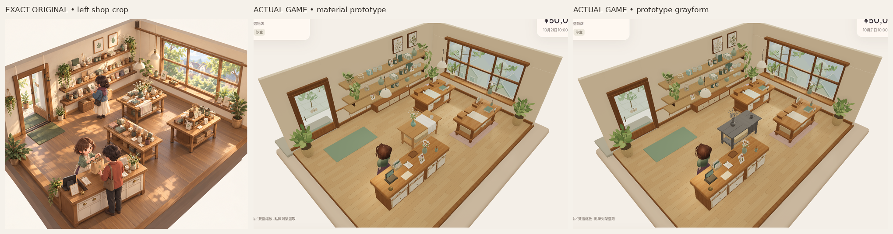
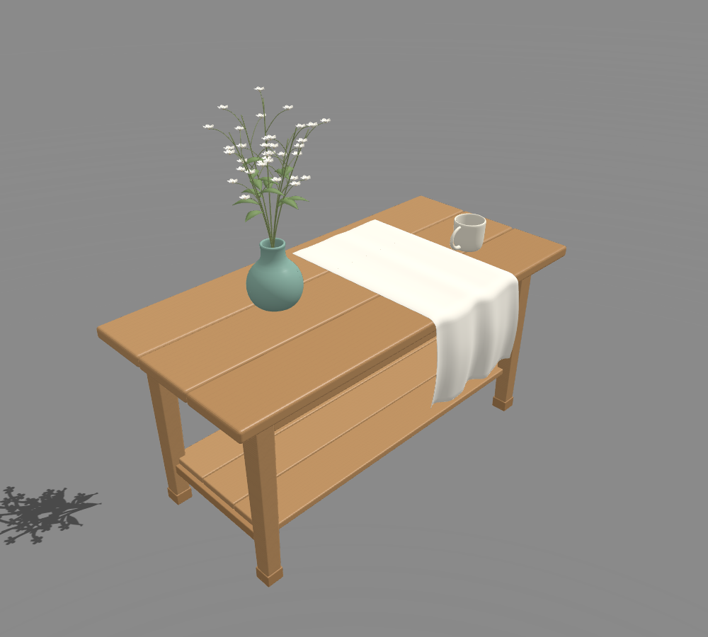

# 第一組底層可重用 3D 部件 — 獨立原型

來源提交：`049dbf31d53436070bcdecadd0ca695ad91ff230`。由 application `78fbae7f519e4c443d5971bb18208e1c4f9de64e` 建立獨立分支 `codex/asset-foundation-v1`。**這是部件原型，整體畫風仍未達原圖、未獲美術接受。** PR8／C50 由另一 maker 處理；本輪沒有改其分支、main、光照參數或公開 Site。

## 原圖與實際畫面

已開啟並查看[唯一完整原圖](codex-v4/reference/Approved_Visual_Target_Misaki.png)的實際像素，1536×1024，SHA256 `9f855d2ecfd120bb45c001db3fa9b5a3e3b58b2b3c2a4cf9e7ebfda84f8f7114`。左店景定義本輪方向；右 Misaki 角色參考留待後續。上方對照只做裁切、等比縮放及標籤；原始 PNG 保留 HUD、正常 shop camera，沒有重新打光、修圖或生成概念圖。

|實際 Babylon／Chromium 畫面|正常遊戲鏡頭|斜角一|斜角二|
|---|---|---|---|
|材質|[完整畫面](reviews/evidence/asset-foundation-v1/material-normal-game.png)|[完整畫面](reviews/evidence/asset-foundation-v1/material-oblique-left.png)|[完整畫面](reviews/evidence/asset-foundation-v1/material-oblique-right.png)|
|只把新部件換灰材質|[完整畫面](reviews/evidence/asset-foundation-v1/gray-normal-game.png)|[完整畫面](reviews/evidence/asset-foundation-v1/gray-oblique-left.png)|[完整畫面](reviews/evidence/asset-foundation-v1/gray-oblique-right.png)|

正常鏡頭使用原 app 設定，沒有 zoom／Zen 替代。斜角是專用作者頁面將**實際引擎相機**設為正常 alpha ±.24 radians；beta、radius、target 保留。這是明示的攝影機調整，沒有移動模型或燈光來迎合截圖。灰模只影響新部件，周圍原店景提供尺度與光照背景。

[相同固定中性光灰模](reviews/evidence/asset-foundation-v1/fixed-light-gray.png)。這兩張是另一個真正 Babylon 場景，載入同一 GLB；固定 neutral key2.1／fill.65、無局部美化燈、無材質貼片陰影。不是角色／整店重建或美術通過證據。

## 部件及重用

|部件|實際幾何／材質|GLB三角形|
|---|---|---:|
|蜂蜜暖木桌|三塊獨立桌板、四根收腳柱、長短圍板、下層分板及承托、木榫；細圓角及真UV木紋|6,480|
|奶油白杯|連續外壁→圓唇→內壁→底面、接到杯身的弧形把手；標準PBR薄clearcoat|6,548|
|青瓷花瓶|連續鼓腹、收肩、瓶頸、圓唇及真內腔；克制glaze|8,448|
|細白花群|七根自然彎曲主莖，分枝從主莖接出，35朵五瓣弧面白花及有厚度葉片|33,124|
|暖白布|連續桌面→圓轉邊→重力垂段，寬褶與不齊下擺，實際2mm厚度|8,992|

整組63,592 triangles、五個組件網格、12個材質 primitive。Blender 原檔保持逐塊木板、輪製剖面、枝條、花瓣及布面可編輯；匯出時只合併副本。尚未製作LOD，花群佔比偏高，不應直接全店大量複製。

- [Blender原檔](../assets/authoring/asset-foundation-v1/display-set.blend)、[重建來源](../tools/asset-foundation/build.py)、[使用／重建說明](../tools/asset-foundation/README.md)。
- [桌](../public/assets/asset-foundation-v1/table.glb)、[杯](../public/assets/asset-foundation-v1/cup.glb)、[瓶](../public/assets/asset-foundation-v1/vase.glb)、[花](../public/assets/asset-foundation-v1/flowers.glb)、[布](../public/assets/asset-foundation-v1/cloth.glb)、[整組](../public/assets/asset-foundation-v1/display-set.glb)。

單位為米，標準glTF RH／Y-up；桌底Y=0、桌面Y=.905m。杯高.143m、瓶高.267m。花群根部局部Y=.21m，插入瓶內；布以桌原點定位。整組只是示範擺位，各部件仍可獨立載入，沒有創建新SKU或給予存貨。

專用 DEV 入口 `tools/asset-foundation/gameplay.html` 載入**原遊戲 app**，只在中央既有位置 `[.1,.08,-.1]` 插入部件組。為免重疊，該預覽只排除舊中央桌及原中央裝飾的對應三角形；其他店景、角色、UI及光照仍是原app。中央商品根節點與存檔程式保留；示範組屬裝飾，不應把玩家商品放在此作者頁面的中央示範面。普通遊戲 `/` 完全不載入這段作者程式。

## 視覺自檢及下一修正

本輪只證明可重用幾何已建立，**仍不能稱為目標畫風PASS**。在正常480px閱讀尺寸，白花偏稀、枝莖的相似向上節奏太明顯；細花頭容易碎成白點。布的穿桌邊問題已修，但垂段仍像幾條較均勻的波紋，欠原圖較寬、轉向明確且有重量的大折面。木構比原簡化盒塊有分板、承托與圓角，但桌面仍偏整齊、平直及均勻；陶器內腔可讀，遠景glaze層次仍弱。周圍舊店景仍保留原有灰棕／平光差距，本輪沒有用光照調參掩蓋。

**下一必要修正：仍只改此組部件**，先把白花整理成高主簇與兩個較低、前後錯開的群落，保留連枝但減少相似等距分枝；布改為兩三個更寬的轉折及受桌邊支撐的折面。完成後用相同正常480px／灰模／固定光／雙斜角再判形體與材質。未過這個部件標準前，不擴展整店、角色或 elaborate lighting。

## 驗證與界線

- `npm run build`、302既有tests、content validate、replay、既有asset-check通過；作者頁兩個TypeScript檔另行strict typecheck通過。完整命令輸出在[checks](reviews/evidence/asset-foundation-v1/checks/)。Vite原有大chunk警告仍在。
- 六個新GLB（五部件及整組）gltf-validator全部零errors／零warnings；[逐檔SHA與bounds](reviews/evidence/asset-foundation-v1/asset-validation.json)。Blender重建可能重排材質及buffer，**不宣稱GLB逐byte可重現**；以提交檔及實際載入hash為準。
- [保留檢查](reviews/evidence/asset-foundation-v1/preservation.json)：720個原有來源／素材／設定逐byte等於指定application；原11歷史、Bible、五語、商品經濟、存檔schema及技術生命週期修正都保留，`.openai/hosting.json`未動。
- 實際新鮮隔離Sandbox UI的買入／上架／reload／Low→High檢查及實際載入GLB SHA記在[capture.json](reviews/evidence/asset-foundation-v1/capture.json)。沒有使用玩家profile，沒有寫玩家Normal。
- Chromium SwiftShader為雲端軟體WebGL；這些靜態畫面不是實體GPU、FPS、連續動作、audio、native、全交易結算／交接或五語窄UI新認證。原圖整體未接受。
- 一張最終正常實拍已保存為Library原生image；其他原始PNG及對照圖留在本分支的不可變commit URL。沒有新Site、payments、merge、deploy或release。
