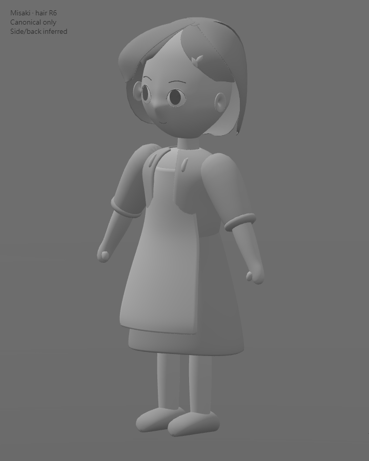
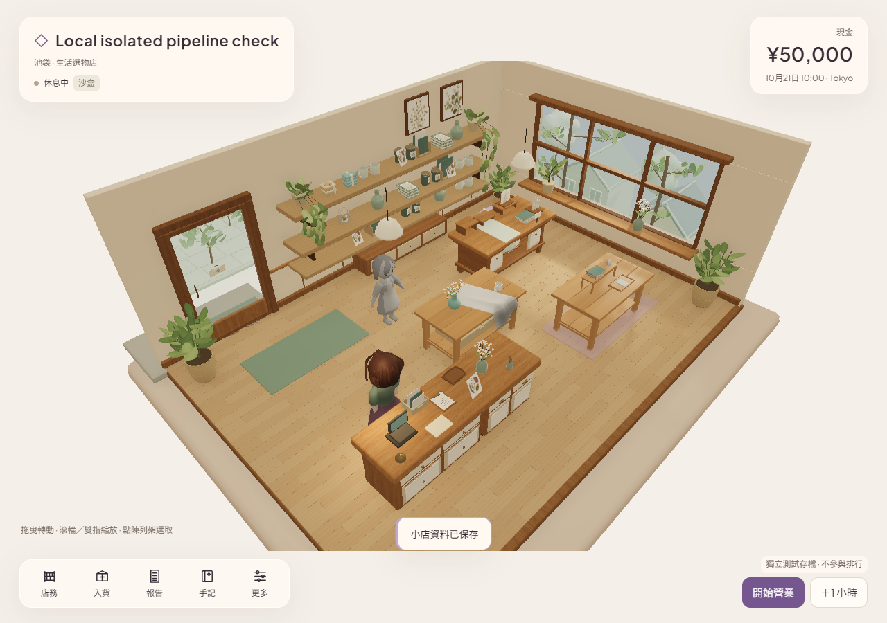
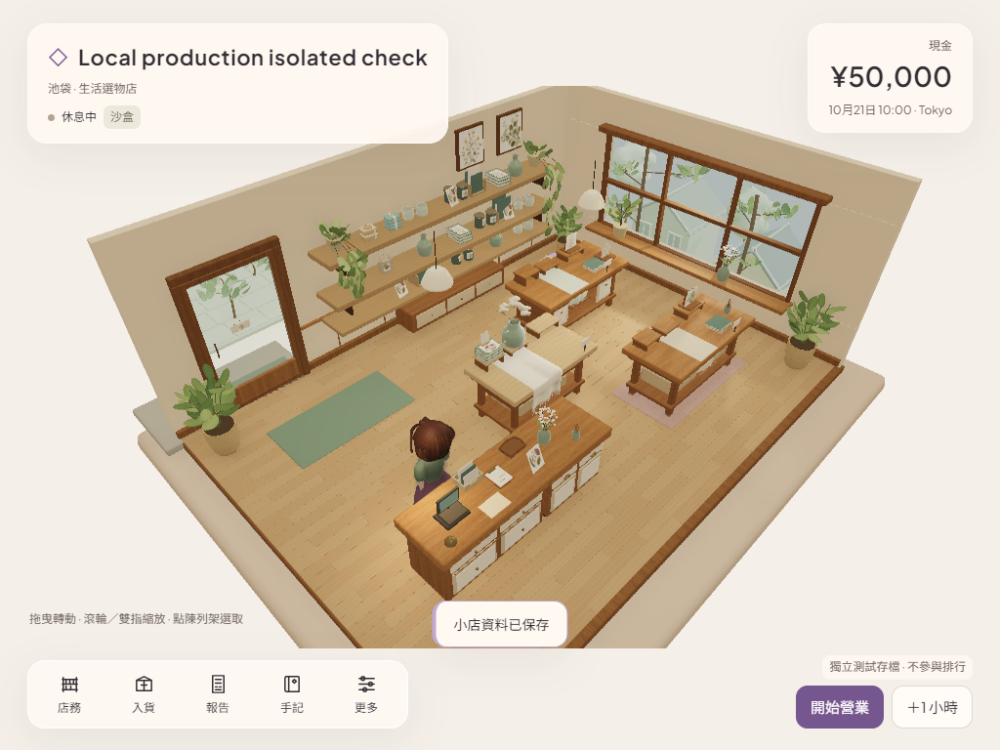

# 本機 Web 開發依賴與實際運行核對

後續：固定共享色表已在保留所有master bytes及原嚴格斷言下修正唯一精度差異，新結果304/304、build／runtime通過；[修正與保護證據](DETERMINISTIC_SRGB8_2026-10-28_zh-HK.md)。Git登入／push hold仍保持，下文是之前301/302階段及憑證阻塞的歷史記錄。

記錄時間：2026-10-28T01:01:44+08:00（Asia/Hong_Kong）。

本機背景 Blender 資產流程、Web build、TypeScript 及隔離瀏覽器實際運行已實證。完整既有測試是 **301／302 通過**，未把剩餘一項失敗隱藏或改成通過。這輪只設置開發工具並驗證原提交，沒有新美術、R6 造型接受、唯一美術 writer 移交或 Unity 遷移。

## 授權與基線

- 使用者明確回覆「允許」，範圍是獨立遊戲工程的鎖定開發依賴，以及 esbuild 必需安裝腳本。沒有全機安裝、系統／網路安全設定變更、Unity 外掛、額外 lifecycle 授權或新憑證。
- 起點為 `codex/asset-foundation-v1` 的 `0638d652ebdca1280320fb93058bc5167bb2e2ca`，遠端實讀同 SHA。原雲端美術作者保持暫停。main／PR8／原 Site／玩家存檔／Library 身份均未操作。
- 原 `package.json`／npm `package-lock.json` 的 canonical Git bytes 保留；沒有改版本或依賴要求。新 pnpm lock 是從既有 npm lock 匯入。

## 限定依賴設置

- 使用已存在的 Node24.19.0、bundled pnpm11.25.0；未加 PATH、未全域安裝。
- 先 `pnpm import`，再 `pnpm install --frozen-lockfile --ignore-scripts`；核對實際25個套件的每一個 name/version 都在原 npm lock，來源均為 registry.npmjs.org。
- 檢查實際套件 manifests／esbuild install.js 後，只執行 `pnpm rebuild esbuild`。唯一執行的依賴 lifecycle 是 `esbuild@0.25.12` 的 `node install.js`。fake-indexeddb／rollup 的來源 prepare scripts未執行，macOS fsevents未啟用；沒有其他必需腳本要求。
- `pnpm-workspace.yaml` 精確允許 `esbuild@0.25.12`、拒絕 fsevents，strictDepBuilds=true；verifyDepsBeforeRun=error 防止未來 run 再自動 install。store及hoisted佈局均在工程內，符合原npm探針的依賴可見性。
- Windows helper只把同一個已安裝／已驗版的 esbuild.exe hard-link到忽略的project `.bin`，解決原測試直接spawn無副檔名命令的Windows差異。實際direct-spawn version檢查通過，沒有改原測試斷言。
- [重用步驟](../tools/local-dev/README.md)。保留可重用的 node_modules／project .pnpm-store，排除Git同步，不重複清空重裝。

## 本機相容處理與來源保護

- sandbox 的 tsx `os.userInfo()` 曾以 `uv_os_get_passwd ENOMEM` 停止；同一檢查經正式執行權限在正常Windows使用者環境成功。沒有patch第三方套件或改用放寬斷言。
- 原 shallow checkout 缺少歷史receipt引用的commits；只從同一授權remote補完整commit graph，使用blob:none減少歷史binary下載，Git按需讀歷史來源。
- Windows原core.autocrlf造成2594個工作檔CRLF；重建LF前逐檔要求轉換結果的Git blob hash與原index完全一致，才寫入。新增專案LF屬性並保留原PDF binary規則；沒有stage或commit大量來源轉換。隨後只對raw bytes等於原blob的5155個檔刷新stat metadata。
- 原測試會改寫 `evidence/native-v4/locomotion-after.json`；本輪結果已另存到新證據目錄，歷史檔按原HEAD bytes復原。其餘原遊戲source／assets／references／hosting身份不變。
- R6 validator只新增 `QA_OUTPUT` 可選輸出位置，所有assertions原封保留；本輪結果寫到新目錄，不覆寫舊R6 evidence。

## 實際執行結果

| 檢查 | 本輪結果 |
| --- | --- |
| test | 302項，301pass／1fail／0skip；沒有修改測試 |
| validate | exit0；10 offerings、5 locales、每語174 keys |
| replay | exit0；cash5020、stock4、net180、units6 |
| asset-check | exit0；既有root glTF／NullEngine檢查通過 |
| build | exit0；原 `tsc --noEmit && vite build`，保留原large-chunk warning |
| authoring strict TS | exit0；studio/gameplay misaki gray entry及其imports另行strict noEmit檢查 |
| R6 validator | exit0；49,368tri、5meshes／10primitives、glTF0error／0warning，29個accepted資產及既有source/streams保護通過 |
| 隔離headless runtime | pass；studio、game authoring及production preview實際3D啟動，0pageerror／0requestfailure |

唯一失敗是 `native-characters.test.ts` 的嚴格GLB hash重建比較。唯讀記憶體診斷發現：Misaki及VisitorB逐byte相同；VisitorA的整個binary chunk、所有accessors／幾何都相同，JSON僅一項 `/materials/15/pbrMetallicRoughness/baseColorFactor/2` 不同：原0.02217388479338738、本機0.022173884793387385，絕對差3.469446951953614e-18。此平台的輸出差異已量測，但底層浮點實作原因未另行證明。**原GLB、manifest及原assert均未改；全套不能稱PASS。** 後續若需跨平台byte-identical重建，須另行決定輸出canonicalization／receipt政策，不能直接覆蓋原master。

## 不搶GUI的實際瀏覽器證據

- 啟動獨立 **headless Chrome156.0.8078.48**，全新nonpersistent contexts；沒有附加既有Chrome或玩家profile，沒有桌面GUI click／typing／focus變動。
- 臨時dev及production preview只bind127.0.0.1；完成後兩server與自身browser均關閉，沒有持續作者／capture job。
- Studio及真正game authoring頁HTTP實載R6 GLB都是902,132bytes，SHA256 `29f4ff9e8711f80cef1f5d899d9c5f0fab0facbf1841274678313581998bb823`；dist copy同SHA，Blender原檔仍 `e8d5b774c5aba9fecbba3800732592c6b1eb66b34e74e6622c0099d6b60ed7a9`。
- 真實新Sandbox透過UI買3杯：cash5000→4790、stock3、shelf2；reload逐值一致，Low→High仍ready，該獨立context的Normal未變。沒有讀寫原玩家profile／Normal存檔。
- Production build正常初始化WebGL2及原UI，沒有載入authoring的R6靜態fixture。這是本機preview，沒有公開部署。
- 實際WebGL回報 **ANGLE Intel UHD Graphics／D3D11**，不是先前雲端SwiftShader。這仍不等於實體玩家操作、持續FPS、音效、手機／Safari或美術視覺接受。
- 三張新截圖已實際視讀，證明場景／UI／模型可見；只是運行證據，不作reference匹配驗收。

機器可用於後續Web-first＋背景Blender資產流程。GUI直接建模、Unity授權／Pipeline整合與單一writer分派仍維持原限制；這輪沒有操作用戶Unity／Hub或改三螢幕協作範圍。

所有本輪設定、工具、最小source／sanitized logs／JSON／PNG會同步到同一隔離分支並核對local=remote。依賴、store、dist、暫存profile及私人日誌不提交；成功readback後才刪除task-owned冗餘驗證輸出，保留可重用依賴及最新可用dist。

## 交接時同步阻塞（尚未同步）

本機source/evidence checkpoint已提交為 `1142d8e7bc987fe1bf041c625e87423bea4fa4f5`。同一Git transport的normal push exit128：`Cannot prompt because user interactivity has been disabled`／`could not read Username for 'https://github.com': terminal prompts disabled`。隨後實讀遠端仍是 `0638d652ebdca1280320fb93058bc5167bb2e2ca`，main仍原SHA，沒有不明推送結果。這是缺少本機Git寫入憑證，不是build失敗，也不是auto-review拒絕。

依「不繞過authentication/permission失敗」限制，已停止推送，未改用另一個API／分支／credential路徑。需要恢復既有GitHub寫入認證，或由父緒取得針對此阻塞的新明確授權後再決定傳輸方式。沒有mint credentials、登入操作、權限擴張、PR retry或公開。尚未同步的新設定／工具／證據／依賴／最新dist均保留；不清理此批unsynced scratch。唯一測試浮點差異與GUI／writer限制不變。
