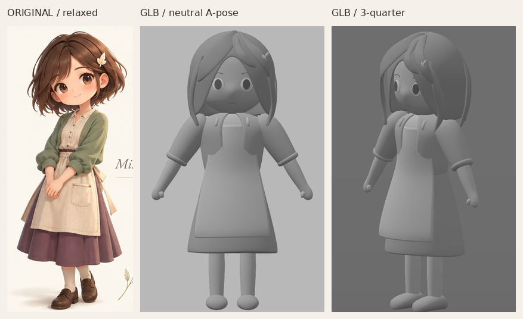
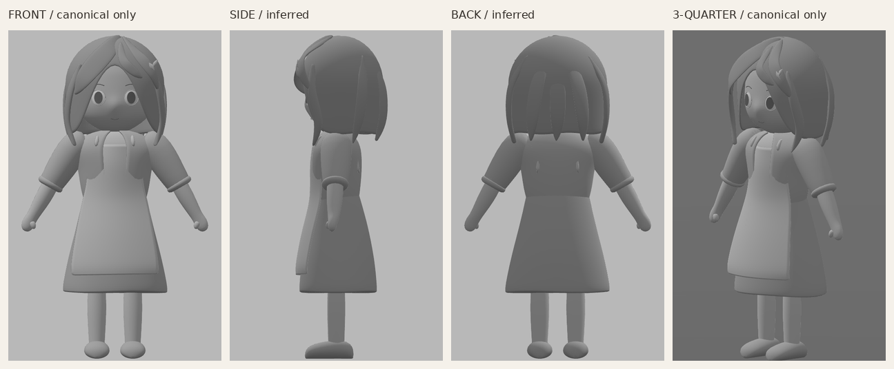
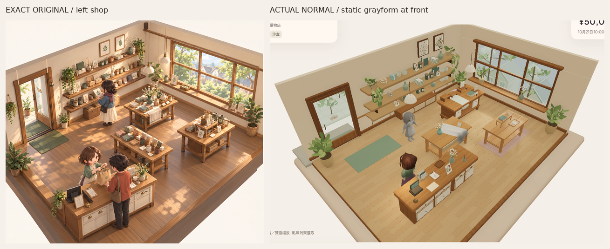

# Misaki頭髮／頭身灰模 v1 — 僅唯一原圖的首候選

Source `038740fbd7f6428cc82d5f442646c2d86a4143e3`，獨立分支`codex/asset-foundation-v1`。已完成可編輯實際3D中性A姿勢、頭／臉／髮量及著衣全身；**灰模尚未獨立接受，整體原圖畫風仍未接受。** PaperR2成組輪廓／分層及R4主形已獨立PASS，兩組全部29個資產／作者檔凍結。本輪沒有全店組裝、最終材質、完整動畫或舊rig替換。

[唯一原圖](codex-v4/reference/Approved_Visual_Target_Misaki.png)仍1536×1024，SHA256`9f855d2ecfd120bb45c001db3fa9b5a3e3b58b2b3c2a4cf9e7ebfda84f8f7114`。已再次看實際像素；原圖控制大頭／柔面／身體比例與髮長。對照只裁切、等比縮放及標籤，沒有修色／描圖／投影；原圖站姿與灰模A姿勢不同，不宣稱正交或精確反求尺寸。

## 這個候選的實物與比例

- 連續臉頰／下顎／額頭表面，鼻部是同一表面的柔和偏移；獨立真眼球面／眼瞼環與眉口位置幾何，沒有portrait貼圖、透明眼卡或影片平面。
- 有厚度、真面部開口的鮑伯髮量，少量寬髮束及不對稱大瀏海；沒有細髮絲。初稿髮尾高於下顎、髮量過闊，已按原圖主形修正：實際髮寬462.67mm，髮尾在下顎以下49.00mm，冠高1.44225m。實際下顎997.48mm，約**3.24268個頭高**；這是作者選擇，不是插畫可量出的實物規格。
- 衣身包括開口罩衫／寬袖與粗袖口、連續前臂→手腕→手掌關節環、連續圍裙、寬裙、襪腿及圓鞋實體。手是粗量體而非手指拓撲；沒有織紋、鞋帶或細裝飾。背蝴蝶結未做，避免把未看的推定當確定參考。
- 髮夾只在**角色自身左側**：Blender面向−Y、左側+X；glTF面向+Z、左側仍+X。側視／背視是從唯一原圖推定的體積，**沒有看過或盲描PlanB新側背圖**。

[可編輯Blender來源](../assets/authoring/misaki-grayform-v1/misaki-grayform.blend)／[GLB](../public/assets/misaki-grayform-v1/misaki-grayform.glb)／[manifest與關節位置](../assets/authoring/misaki-grayform-v1/manifest.json)／[重建及作者頁](../tools/asset-foundation/MISAKI_GRAY_README.md)。來源保留42個語意物件、6,130控制頂點／5,536四邊面及細分修改器；輸出才烘焙成5組。臉仍是環狀量體＋眼部位置件，沒有最終眼孔／表情edge-flow、權重或rig認證；衣物交疊也未當動畫碰撞已過。

## 實際四面及正常遊戲尺度

[完整正面](reviews/evidence/misaki-grayform-v1/grayform-front.png)／[側面](reviews/evidence/misaki-grayform-v1/grayform-side.png)／[背面](reviews/evidence/misaki-grayform-v1/grayform-back.png)／[三分四面](reviews/evidence/misaki-grayform-v1/grayform-threequarter.png)。正側背為正交閱讀，三分四面同正交尺度略俯視；全程固定中性key2.1／fill.65，沒有逐角調光或高光遮比例。七個材質只有灰值、roughness1，並非最終皮膚／衣髮材質。

[實際正常完整PNG](reviews/evidence/misaki-grayform-v1/grayform-game-normal.png)／[左斜角](reviews/evidence/misaki-grayform-v1/grayform-game-oblique-left.png)／[右斜角](reviews/evidence/misaki-grayform-v1/grayform-game-oblique-right.png)。新灰模在空走道`[.85,.079,1.35]`、yawπ，面向−Z；原櫃位彩色Misaki仍是原遊戲staff，沒有替換rig、動作、identity或經濟能力。灰模不pick、沒有動畫綁定，只在DEV作者頁載入；普通`/`未匯入。正常camera、全燈及R4／PaperR2材質設定與紙本R2逐值同；斜角只alpha±.24，沒有zoom放大灰模。

## 尚未過的主形／風格

大頭、短身、下顎以下的短鮑伯及衣裙體積已能作比例檢查，但**臉眼仍有泛人偶感、鼻額／眼眶轉折弱；寬髮束仍厚硬、後腦髮殼感強；罩衫／圍裙重力也偏幾何。** 這不是原圖角色完成，也不能以較順滑或三角面數當接受。下一步先取得可讀PlanB像素，按[參考優先級／左右髮夾／不一致姿勢規則](MISAKI_NEXT_STAGE_REFERENCE_HANDOFF_2026-10-27.md)交叉判頭髮、側臉及全身比例；只修量體，不進最終貼圖／rig／動畫／細髮或手指。

## 本輪驗證

[摘要](reviews/evidence/misaki-grayform-v1/summary.json)／[glTF及全節點bounds](reviews/evidence/misaki-grayform-v1/asset-validation.json)／[來源逐物件實際bounds](reviews/evidence/misaki-grayform-v1/source-object-bounds.json)／[原始capture紀錄](reviews/evidence/misaki-grayform-v1/capture.json)。

- 1個新GLB零error／warning、47,576tri、5meshes／10primitives／7灰材質、868,528bytes、零images／skins／animations。實際最低Y=0，最高Y1.442250321m，髮夾只在左+X且前+Z。29個已過組件檔逐byte凍結、原application720檔逐byte同base。
- 本輪Blender4.3.2生成、strict作者TS、最終build、幾何／灰材質／原點／來源凍結檢查及freshSandbox流程。前checkpoint302tests等保留，本輪未重跑不測新灰模比例的app tests。
- studio與遊戲實載GLB SHA相同並對上提交素材；原正常camera／全燈逐值同PaperR2。fresh Sandbox真UI買3杯5000→4790／stock3／未改display3槽2上架／reload逐值同／Low→High／隔離Normal不變，0pageerror。沒有玩家Normal寫入，沒有宣稱已驗完整舊角色動畫。
- 作者場景共119,272tri（新灰模47,576＋凍結組件71,696），沒有bulk複製。雲端SwiftShader靜態證據不是實體GPU／FPS／audio／native、全碰撞或最終拓撲／美術驗收。

## 尚待解決的參考讀取

正常完整實拍已另存原生Library image：`libfile_0224bad58e5881918df7c73f50e81481`，**grayform-game-normal.png version0**，file ID`file_00000000f0588207a5ff847f315f86d2`，642,403bytes；R4及紙本image identity／舊版保留。

目標是Library `libfile_d1f1a5f43d9c819199f7d57ff7936d6a` 的`Misaki_RefPack_PlanB.zip`；預期SHA256`4c35ad580dfff13001d4970a7bc2b1be5299c944d127abb0fdd329f7dad6e420`。本consumer透過現行Library skill準備成功，回傳file`file_0000000062c081f5b77bad436e49ac5c`／version0／10,875,267bytes metadata；官方`library_file_transfer.py materialize`回報 **`download failed`**，本機確認沒有ZIP，Library read沒有可讀內容。**失敗原因未明，並非收到審批拒絕；PlanB bytes／SHA及13張新圖均未在此環境核實。** 沒有自行curl、換路徑、盲重試或幻想新視圖。已按授權完成唯一原圖可做的工作；待參考可讀後才能完成這部分比對。

PR建立維持先前拒絕停止，無retry／換route；main／PR8／merge／公開Site／payments／玩家Normal未改。除上述PlanB讀取／比對未完成外，沒有其他操作阻塞。
