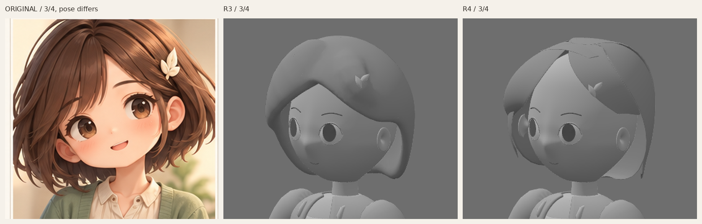
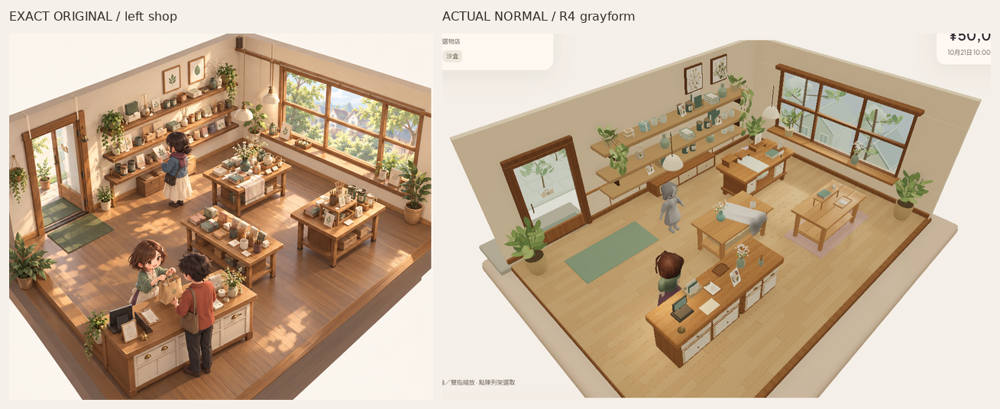

# Misaki R4 — 只改髮束控制曲面，身份仍未接受

獨立覆核已判 **R4 hair identity FAIL**：主瀏海仍高平／額位過露及冠根斷續；[R5改用獨立內部截面控制](MISAKI_HAIR_R5_2026-10-27_zh-HK.md)，保留全部非髮幾何。以下為原固定候選紀錄。

Source `42d99f7d01515577e46605fa43f635e0708ee3e0`，只在未合併的 `codex/asset-foundation-v1`。R3 獨立 identity gate **FAIL**：球形基礎控制加 6mm voxel fusion 及 12 次全局 smoothing 抹掉髮束流向／重疊。這次換作者方法，不把問題說成三角面預算或引擎瓶頸；**R4 仍未獲身份／原圖畫風接受**。

[正面對照](reviews/evidence/misaki-grayform-v1-r4/original-r3-r4-front-head480.png)／[側面對照（推定）](reviews/evidence/misaki-grayform-v1-r4/original-r3-r4-side-head480.png)。R3／R4 用相同原始 camera／裁切／等比縮放；原圖仍是不同三分四姿勢／投影，只按冠至下顎近似匹配尺度。僅裁切、縮放、排列與標籤，無修色／重畫或虛構新側圖。[唯一原圖](codex-v4/reference/Approved_Visual_Target_Misaki.png)1536×1024、SHA256 `9f855d2ecfd120bb45c001db3fa9b5a3e3b58b2b3c2a4cf9e7ebfda84f8f7114`；這次重新看原頭像實際像素。PlanB 未看，兩次失敗後沒有新 transfer。

## 實際改動與尚欠

- 六個有厚度的獨立髮束曲面：主導斜瀏海、其下太陽穴內轉、較短的自身左露耳側分、三個不等長的後髮流面。另有一個局部拱形冠頂 underlap 承托髮根，並非全頭球殼。前後 overlap／細薄不等尾端／間隙保留，沒有全頭融合、全局平滑、decimation 或細髮。
- 每束有兩邊 cubic／piecewise cubic Bezier 控制、寬向 crest 和不同厚度；兩層12×6控制格封邊，僅局部 subdivision1。厚度控制約1.4–10mm，冠根降低厚度避免厚片站起。`.blend` 保存14條隱藏原生 Bezier edge guides及控制屬性；guides作可編輯參照，並非拖動即自動驅動cage，改控制後可由作者碼重建。
- 髮夾葉形保持剛體，只依新髮面重新附著，自身左+X；156個實際頂點 unsigned 距離約0.106–6.140mm，平均3.454mm。這是取樣接近資料，並非完整接觸／碰撞認證。
- **自檢仍有不足：主瀏海大面仍偏平／片狀，冠頂根接合仍見硬邊／斷續，後緣仍工整；原圖蓬鬆的側向量體、自然回捲和流向尚未成立。** 新方法可分束修中等曲率，但不能因看見分界便判 identity PASS。原圖瀏海較低而鬆，這版前額暴露仍偏大。下一個必要修正仍是冠根到主瀏海的曲率／側後髮流向與不規則鬆尾，保留本輪凍結的眼面頸身體；不進細髮／衣服／最終材質／rig／動畫。

## 相同全身尺度及真正遊戲畫面

[正面R3→R4全身](reviews/evidence/misaki-grayform-v1-r4/r3-r4-front-body-same-scale480.png)／[三分四](reviews/evidence/misaki-grayform-v1-r4/r3-r4-threequarter-body-same-scale480.png)／[側面](reviews/evidence/misaki-grayform-v1-r4/r3-r4-side-body-same-scale480.png)。固定720×900 viewport／正交bounds、key2.1＋fill.65；camera／light TS來源原檔、七個灰材質都保留。

[R3→R4正常480px](reviews/evidence/misaki-grayform-v1-r4/r3-r4-normal-shop480.png)／[完整正常PNG](reviews/evidence/misaki-grayform-v1-r4/grayform-game-normal.png)／[左斜角](reviews/evidence/misaki-grayform-v1-r4/grayform-game-oblique-left.png)／[右斜角](reviews/evidence/misaki-grayform-v1-r4/grayform-game-oblique-right.png)。位置仍 `[.85,.079,1.35]`、yawπ，正常camera與全燈同R3，斜角只alpha±.24，無zoom。原彩色staff／rig／actions不替換，普通`/`不載入作者灰模；背景及衣身仍是凍結內容。

[完整正面](reviews/evidence/misaki-grayform-v1-r4/grayform-front.png)／[三分四](reviews/evidence/misaki-grayform-v1-r4/grayform-threequarter.png)／[側面推定](reviews/evidence/misaki-grayform-v1-r4/grayform-side.png)／[背面推定](reviews/evidence/misaki-grayform-v1-r4/grayform-back.png)。

## 來源與驗證範圍

[可編輯Blender](../assets/authoring/misaki-grayform-v1/misaki-grayform.blend)／[實際GLB](../public/assets/misaki-grayform-v1/misaki-grayform.glb)／[新髮控制碼](../tools/asset-foundation/misaki-hair-r4.py)／[重建說明](../tools/asset-foundation/MISAKI_GRAY_README.md)／[摘要](reviews/evidence/misaki-grayform-v1-r4/summary.json)／[capture紀錄](reviews/evidence/misaki-grayform-v1-r4/capture.json)。

- 新GLB49,368tri（髮7,952）、5meshes／10primitives／7灰材質、902,128bytes，零images／skins／animations；glTF零error／warning。連原道具作者場景121,064tri，沒有bulk replication，亦無LOD／裝置效能接受。GLB SHA256 `255d914c3ce1bff943baf0f21c120891c05fb6e904d096884fb19f5eec0cf91d`。
- R3臉／feature-placement／衣身24組POSITION／NORMAL／index streams及nodeTRS逐byte一致，故眼形／角位及R2連續頰顎鼻額／頸耳與衣物未改。七個灰材質與studio camera/light來源相同，29個已過R4／PaperR2資產作者檔及720原application保護檔相同。feetY0；兩個眼孔各40條evaluated邊、頸頭縱bounds重疊58.38mm／chin至衣頂35.18mm保留，非watertight／碰撞保證。
- 本輪Blender4.3.2、GLB標準／scope／frozen streams-materials-assets／read-only來源檢查、strict作者TS與finalbuild；source／dist／studio／game實載SHA相同。[asset驗證](reviews/evidence/misaki-grayform-v1-r4/asset-validation.json)／[來源取樣](reviews/evidence/misaki-grayform-v1-r4/source-inspection.json)／[720檔保護](reviews/evidence/misaki-grayform-v1-r4/application-preservation.json)。
- freshSandbox真UI買3杯5000→4790、stock3、原display3槽2上架、reload逐值同、Low→High／Normal隔離不變及0pageerror。前302tests／content／replay／legacyassetchecks未重跑；靜態SwiftShader非physicalGPU／FPS／audio／native／完整舊角色動作或美術認證。

原生Library同一正常image已更新 **version3**：`libfile_0224bad58e5881918df7c73f50e81481`，`grayform-game-normal.png`，file ID `file_000000001d908211b73e9df28e1cb0e0`，641,967bytes；舊0／1／2版本保留。[保存結果](reviews/evidence/misaki-grayform-v1-r4/library-image.json)。

PlanB依舊停止：初次與唯一fresh consumer-local retry皆官方helper exit1、`library file transfer failed: download failed`；兩目的地均無ZIP／新圖／本機SHA。原因未明、非審批拒絕；[精確無secret紀錄](reviews/evidence/misaki-grayform-v1-r4/reference-access.json)原樣保留。本輪無新試／猜URL／genericdownload／替代credentials。PR建立維持先前拒絕停止，無retry或換route；無main／PR8寫入、merge、Site公開、payments或玩家Normal變更。除PlanB未能比對外，無其他操作阻塞。
