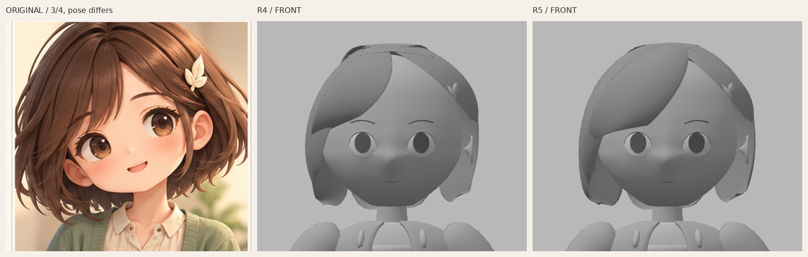
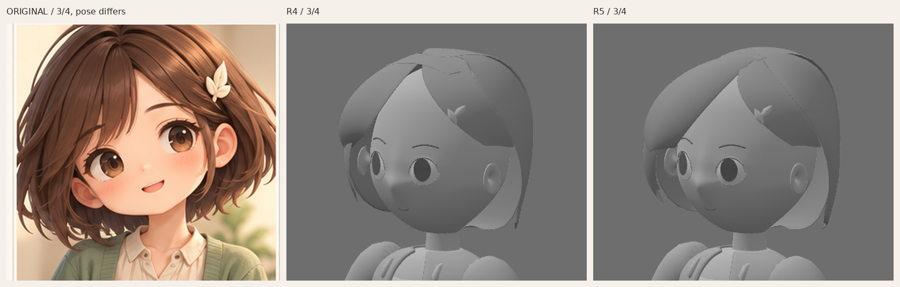
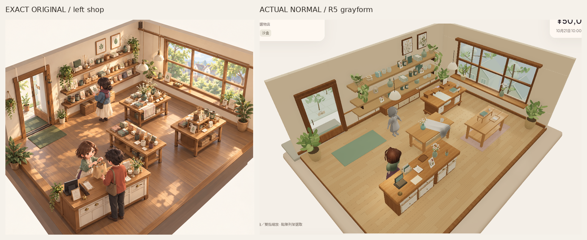

# Misaki R5 — 主掃內部截面與局部髮根，身份仍未接受

Source `1e9680481bc16273b09bd1db39917dc06ba0f276`，只在未合併 `codex/asset-foundation-v1`。R4獨立hair identity **FAIL**後，保留分束曲面方法，優先改主瀏海及髮根，不加細髮或三角面。**R5仍未獲identity／原圖畫風接受**；眼面頸身體、髮夾、材質、camera/light凍結，不轉衣服／rig／動畫。

[側面對照（推定）](reviews/evidence/misaki-grayform-v1-r5/original-r4-r5-side-head480.png)。模型R4／R5用同一camera、同裁切／等比縮放；原圖保留不同三分四姿勢及投影，僅按冠至下顎近似頭尺度匹配，不當正交front/side。只有裁切／縮放／排列／標籤，無修色重畫。[唯一原圖](codex-v4/reference/Approved_Visual_Target_Misaki.png)1536×1024、SHA256 `9f855d2ecfd120bb45c001db3fa9b5a3e3b58b2b3c2a4cf9e7ebfda84f8f7114`，本輪重新看頭像實際像素；未取得／觀看PlanB新圖，側背仍推定。

## 形體與作者方法

- 主瀏海從偏側分線區掃向自身右眉側，下降遮住較多額位。新增獨立內部Bezier spine，與左右邊界共同決定每個寬向曲截面；中間位置可獨立前後／上下／左右改變，並非兩邊linear interpolation再加少量scalar bulge。實際source cage中段8個截面中心與邊界直連的距離約12.9–39.3mm；只證明中間曲率控制存在，不是身份評分。
- 髮根收束到同一小偏側分線區，局部曲面承托；太陽穴及三個側後流面也加入獨立spine，讓頂根到側量體有外鼓再內收的轉向，減少原來直跨截面留下的大冠根缺口。不同髮束仍有前後overlap與不等下緣；沒有全頭融合、voxel remesh、全局smoothing、decimation或加細髮。局部重疊不是整頭拓撲焊接，不當watertight完成。
- 七個封邊兩層12×6cage仍只subdivision1；其中六個有獨立spine，短露耳／夾側保留border控制。`.blend`保存20條隱藏原生Bezier guides及控制屬性，guide是可編輯參照而非live驅動；可直接改cage或修改作者控制後重建。
- 髮夾完全保留R4控制座標／geometry／TRS，沒有重新移位掩飾接觸。156頂點對目前髮面的unsigned距離約0.103–6.171mm，mean3.267mm，僅取樣接近資料，非signed collision／完整attachment認證。

**自檢仍欠：主瀏海仍像很寬的一束，下緣偏切齊；冠根及前後overlap仍能見硬轉，後髮仍偏重、下緣太整。** 新截面令主掃下降、冠頂大缺口減少，尚不能當原圖的自然鬆軟bob或Misaki身份已過。下一步應獨立判主掃位置／厚薄轉向及冠根，再決定是否進一步調整側後量體；不先加細髮、材質或衣物。

## 真正遊戲尺度及完整角度

[正面全身R4→R5同尺度](reviews/evidence/misaki-grayform-v1-r5/r4-r5-front-body-same-scale480.png)／[三分四](reviews/evidence/misaki-grayform-v1-r5/r4-r5-threequarter-body-same-scale480.png)／[側面](reviews/evidence/misaki-grayform-v1-r5/r4-r5-side-body-same-scale480.png)。studio仍720×900、相同正交bounds／key2.1／fill.65；camera-light TS原檔與7灰材質定義完全相同。

[R4→R5正常480px](reviews/evidence/misaki-grayform-v1-r5/r4-r5-normal-shop480.png)／[正常完整PNG](reviews/evidence/misaki-grayform-v1-r5/grayform-game-normal.png)／[左斜角](reviews/evidence/misaki-grayform-v1-r5/grayform-game-oblique-left.png)／[右斜角](reviews/evidence/misaki-grayform-v1-r5/grayform-game-oblique-right.png)。位置仍`[.85,.079,1.35]`、yawπ，正常camera及全燈同R4，斜角只alpha±.24，無zoom。背景及衣身屬凍結內容，不當本次頭髮成果。普通`/`不載入靜態DEV灰模；原彩色staff／rig／actions保留。

[完整正面](reviews/evidence/misaki-grayform-v1-r5/grayform-front.png)／[三分四](reviews/evidence/misaki-grayform-v1-r5/grayform-threequarter.png)／[側面推定](reviews/evidence/misaki-grayform-v1-r5/grayform-side.png)／[背面推定](reviews/evidence/misaki-grayform-v1-r5/grayform-back.png)。

## 實際來源／檢查與限制

[Blender](../assets/authoring/misaki-grayform-v1/misaki-grayform.blend)／[GLB](../public/assets/misaki-grayform-v1/misaki-grayform.glb)／[髮控制碼](../tools/asset-foundation/misaki-hair-r5.py)／[R4凍結髮夾控制](../tools/asset-foundation/misaki-frozen-clip-r4.json)／[重建說明](../tools/asset-foundation/MISAKI_GRAY_README.md)／[摘要](reviews/evidence/misaki-grayform-v1-r5/summary.json)／[capture](reviews/evidence/misaki-grayform-v1-r5/capture.json)。

- GLB49,368tri／髮7,952，與R4完全同面數；5meshes／10primitives／7灰材質／902,132bytes，零images／skins／animations，glTF零error／warning。連凍結道具作者場景121,064tri，無bulk複製／LOD或裝置效能接受。SHA256 `d8683a45bf52cb06c1e00d8658da6130201d0f484ce1c39bea392927bce7aa36`。
- 全部非髮group包括髮夾的27組POSITION／NORMAL／index streams及nodeTRS逐byte同R4。R3face-feature-body24組、R2頰顎鼻額／頸耳定義及45mm頭offset亦另驗保留；7灰材質、studio相機燈TS、29既有資產作者檔及720原application保護檔同。feetY0、眼孔兩圈各40evaluated邊、頸頭縱bounds overlap58.38mm／chin至凍結衣頂35.18mm保留，非皮膚／碰撞認證。
- 本輪Blender4.3.2／strict GLB／非髮byte-TRS／材質／資產／read-only眼孔頸位與clip／20guides-內部截面取樣／strict作者TS及finalbuild通過；source-dist-studio-game實載SHA同，R4/R5 camera與全燈逐值同。[asset驗證](reviews/evidence/misaki-grayform-v1-r5/asset-validation.json)／[來源取樣](reviews/evidence/misaki-grayform-v1-r5/source-inspection.json)／[720檔保護](reviews/evidence/misaki-grayform-v1-r5/application-preservation.json)。
- freshSandbox真UI買3杯5000→4790／stock3／原display3槽2上架／reload逐值同／Low→High／Normal隔離不變／0pageerror。前302tests／content／replay／legacychecks未重跑。SwiftShader靜態非physicalGPU／FPS／audio／native或完整舊動作認證，技術通過不代表畫風接受。

Library同一正常image已更新 **version4**：`libfile_0224bad58e5881918df7c73f50e81481`，`grayform-game-normal.png`，file ID `file_000000003850821199984010a36feb86`，641,214bytes；舊0–3版本保留。[保存結果](reviews/evidence/misaki-grayform-v1-r5/library-image.json)。

PlanB初次＋唯一fresh supported retry仍兩次官方helper exit1、`library file transfer failed: download failed`，兩目的地無ZIP／新圖／本機SHA，原因未明非denial；[精確無secret失敗紀錄](reviews/evidence/misaki-grayform-v1-r5/reference-access.json)原樣保留，沒有新retry或替代下載。PR建立維持先前拒絕停止，無retry／換route；無main／PR8寫入、merge、Site公開、payments或玩家Normal變更。除PlanB未比對外，無其他操作阻塞。
