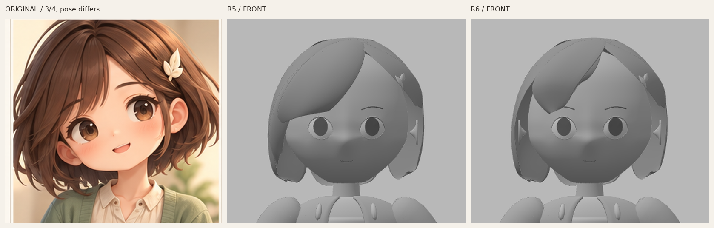
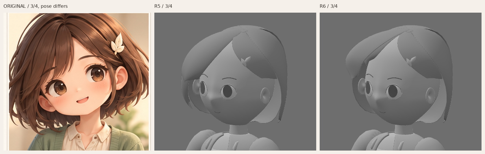
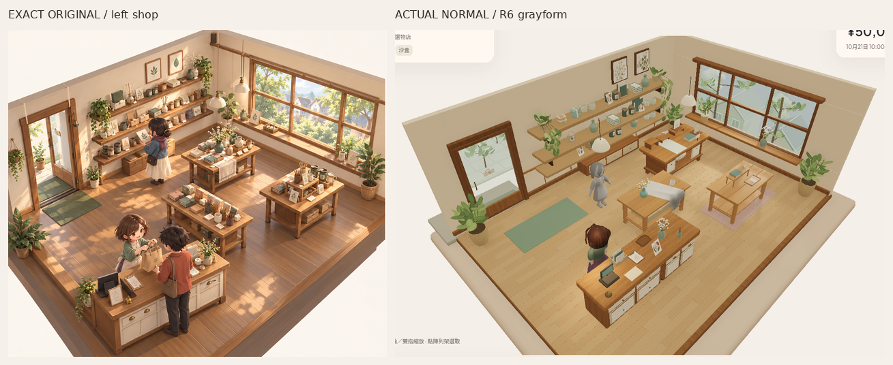

# Misaki R6 — 只重排主瀏海與較短承托掃形

Source `9e62928511d0da45012c05d3197e0bc5d04bc309`，仍只在未合併 `codex/asset-foundation-v1`。R5獨立hair identity **FAIL**，但較低主掃、截面曲率及冠頂缺口改善獲確認。本輪只改前髮10／11兩個控制面，保留spine方法；其餘五髮面及全部非髮幾何凍結。**R6仍未獲identity／原圖畫風接受**，不修後髮、眼、衣物、材質或rig。

模型R5／R6同camera、同原始crop與等比縮放；原圖保留不同三分四姿勢／投影，只按冠至下顎近似尺度匹配，不當正交front/side。只有裁切／縮放／排列／標籤，無修色或重畫。[唯一原圖](codex-v4/reference/Approved_Visual_Target_Misaki.png)1536×1024、SHA256 `9f855d2ecfd120bb45c001db3fa9b5a3e3b58b2b3c2a4cf9e7ebfda84f8f7114`，本輪再次看實際頭像像素；先檢查front及三分四，再固定遊戲候選。PlanB未取得新圖，側背仍推定。

## 這次的控制布局

- 主掃10改成兩段Bezier控制：偏側根、寬肩、斜降轉向與較窄不等端點；邊界及內部spine分別改變方向／深度，沒有整束統一縮高或縮寬。source肩部抽樣橫寬約127–133mm，末段33mm；收向自身右眉側，不再保留R5寬橫切端面。
- 原太陽穴長面11重排為主掃內側較短承托面，以不同路徑退後露出。肩部抽樣約81–91mm、末段29mm；terminal centre比主掃約高76mm、後退20mm（Blender front−Y）。兩束不共用同一長切邊。這些是本候選幾何量測，不是目標數字規格。
- 原偏側root控制、局部冠根承托16及其餘12–15面保留。兩層12×6cage、subdivision1、六個獨立spine、20條原生Bezier guides及7,952髮tri完全同數量，沒有加細髮、材質或拓撲預算；guides是可編輯參照而非live cage driver。

**自檢仍欠：主掃仍有單葉片／過整感，對原圖額面的包覆偏少；短束在三分四仍偏弱，兩束overlap未達原圖自然流動。** 這版重排了主次掃形及不同端點，但不能把控制布局改變當作身份已過。下一步應繼續獨立判前髮主次及額面包覆，改善主束葉片感／承托銜接；未判之前不再修後髮或加細節。凍結後髮的重量／整齊度並非本輪成果。

## 真正正常尺度與完整角度

[正面R5→R6全身同尺度](reviews/evidence/misaki-grayform-v1-r6/r5-r6-front-body-same-scale480.png)／[三分四](reviews/evidence/misaki-grayform-v1-r6/r5-r6-threequarter-body-same-scale480.png)／[側面](reviews/evidence/misaki-grayform-v1-r6/r5-r6-side-body-same-scale480.png)。固定720×900／正交bounds／key2.1＋fill.65，studio camera-light TS原檔與七灰材質定義保留。

[R5→R6正常480px](reviews/evidence/misaki-grayform-v1-r6/r5-r6-normal-shop480.png)／[正常完整PNG](reviews/evidence/misaki-grayform-v1-r6/grayform-game-normal.png)／[左斜角](reviews/evidence/misaki-grayform-v1-r6/grayform-game-oblique-left.png)／[右斜角](reviews/evidence/misaki-grayform-v1-r6/grayform-game-oblique-right.png)。位置`[.85,.079,1.35]`、yawπ及正常camera／全燈同R5，斜角只alpha±.24，無zoom。舊背景／衣物不當頭髮成果；普通`/`不載入作者灰模，原彩色staff／rig／actions／資料及存檔不替換。

[完整front](reviews/evidence/misaki-grayform-v1-r6/grayform-front.png)／[三分四](reviews/evidence/misaki-grayform-v1-r6/grayform-threequarter.png)／[side推定](reviews/evidence/misaki-grayform-v1-r6/grayform-side.png)／[back推定](reviews/evidence/misaki-grayform-v1-r6/grayform-back.png)／[原圖與side](reviews/evidence/misaki-grayform-v1-r6/original-r5-r6-side-head480.png)。

## 來源與必要檢查

[Blender](../assets/authoring/misaki-grayform-v1/misaki-grayform.blend)／[GLB](../public/assets/misaki-grayform-v1/misaki-grayform.glb)／[R6控制碼](../tools/asset-foundation/misaki-hair-r6.py)／[五髮面scope檢查](../tools/asset-foundation/check-misaki-r6-scope.py)／[重建說明](../tools/asset-foundation/MISAKI_GRAY_README.md)／[摘要](reviews/evidence/misaki-grayform-v1-r6/summary.json)／[capture](reviews/evidence/misaki-grayform-v1-r6/capture.json)。

- 其餘五面12–16由pinned R5 `.blend`實際載入暫存記憶，逐面比較細分後position／normal／triangles及world matrix，全部相同；不改寫baseline或目前`.blend`。[scope紀錄](reviews/evidence/misaki-grayform-v1-r6/scope-preservation.json)。
- 全部非髮含髮夾的27組POSITION／NORMAL／index streams及nodeTRS逐byte同R5。R3face-feature-body24組、R2頰顎鼻額／頸耳及45mm offset另驗保留；七灰材質、studio相機燈TS、29既有資產作者檔及720原application保護檔相同。
- GLB49,368tri／髮7,952（與R5同）、5meshes／10primitives／7灰材質／902,132bytes，零images／skins／animations，零error／warning；SHA256 `29f4ff9e8711f80cef1f5d899d9c5f0fab0facbf1841274678313581998bb823`。凍結道具相鄰作者場景121,064tri，不bulk／不當LOD或裝置效能通過。
- feetY0、兩個真眼孔各40evaluated邊、頸頭縱bounds overlap58.38mm／chin至衣頂35.18mm保留。原位自身左+X夾156個頂點到髮面的unsigned距離0.103–6.171mm，mean3.267mm，同R5；非完整attachment／signedcollision或皮膚watertight認證。
- 本輪Blender4.3.2、GLB／scope5髮面／非髮27streams-TRS／材質資產／read-only來源與兩前髮布局取樣／strict作者TS及finalbuild通過；source-dist-studio-game實載SHA同，R5/R6正常camera／全燈及studio條件逐值同。[asset](reviews/evidence/misaki-grayform-v1-r6/asset-validation.json)／[來源量測](reviews/evidence/misaki-grayform-v1-r6/source-inspection.json)／[720檔保護](reviews/evidence/misaki-grayform-v1-r6/application-preservation.json)。
- freshSandbox買3杯5000→4790／stock3／原display3槽2上架／reload逐值同／Low→High／Normal隔離不變／0pageerror。前302tests／content／replay／legacychecks未重跑。SwiftShader靜態非physicalGPU／FPS／audio／native／完整舊動作或美術認證；沒有以meshbudget或engine瓶頸解釋造型差距。

Library同一正常image更新 **version5**：`libfile_0224bad58e5881918df7c73f50e81481`，`grayform-game-normal.png`，file ID `file_0000000042108207a2465fc555a6b614`，641,678bytes；舊0–4保留。[保存結果](reviews/evidence/misaki-grayform-v1-r6/library-image.json)。

PlanB初次＋唯一fresh supported retry仍兩次官方helper exit1／`library file transfer failed: download failed`；兩目的地無ZIP／新圖／本機SHA，原因未明非denial。[精確原紀錄](reviews/evidence/misaki-grayform-v1-r6/reference-access.json)原樣保留，沒有新retry／替代下載。PR建立維持先前拒絕停止，無retry／換route；無main／PR8寫入、merge、Site公開、payments或玩家Normal變更。除PlanB未比對外，無其他操作阻塞。
