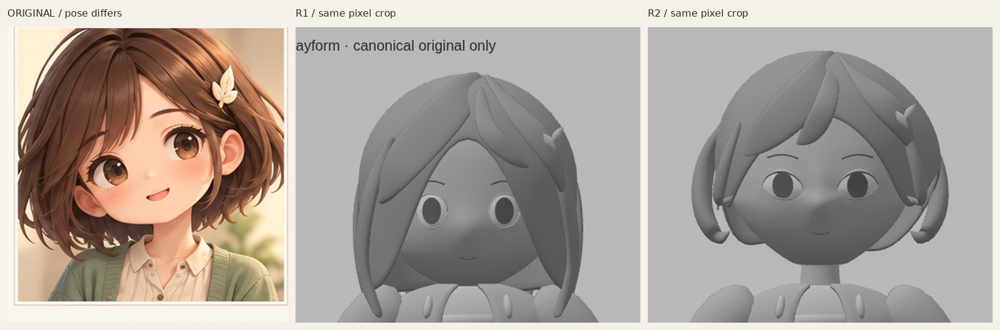
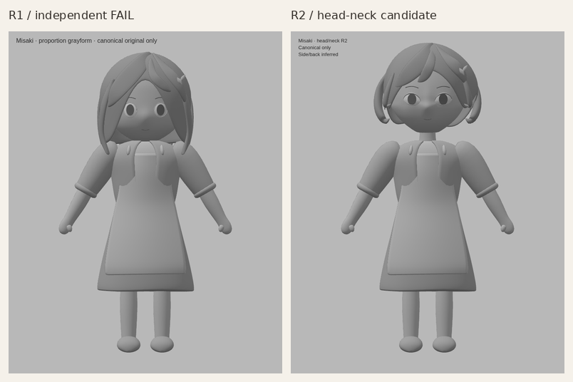
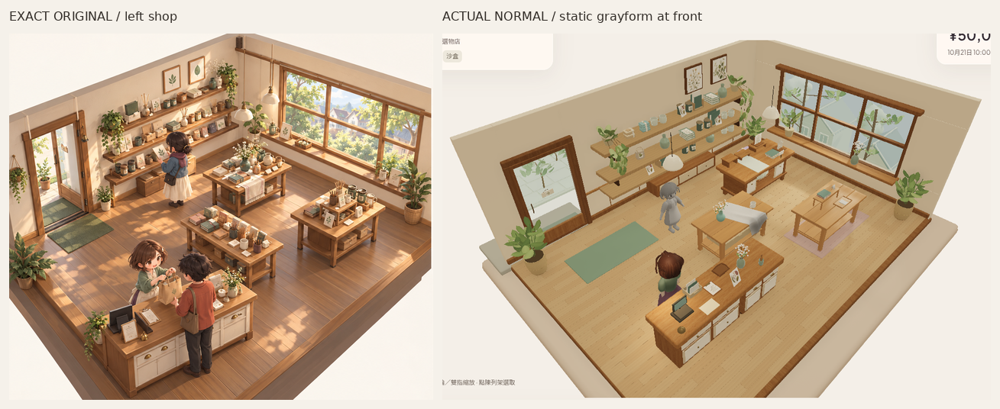

# Misaki R2 — 只修頭／臉／髮量／頸部的固定候選

Source `45d596e9d27f67c48c163033374f8981bbbeb65a`，獨立分支`codex/asset-foundation-v1`。首灰模獨立FAIL後，本輪只做頭頸，**R2未判風格PASS，整體原圖畫風仍未接受**。衣身／硬袖口／平圍裙／裙／手腳暫時凍結，留待頭頸過關後；R4與PaperR2亦全部凍結。不做最終材質、rig、動畫、細髮或手指。

[唯一原圖](codex-v4/reference/Approved_Visual_Target_Misaki.png)仍1536×1024，SHA256`9f855d2ecfd120bb45c001db3fa9b5a3e3b58b2b3c2a4cf9e7ebfda84f8f7114`。重新看了完整原像素及原頭像裁切，沒有使用未取得的PlanB新圖。對照只有裁切、等比縮放、排列／標籤；無修色、描圖、iris貼圖或高光遮形。原圖有頭傾／透視，不能當正交尺寸或數字比例規格。

## 本輪形狀改動

- 原本窄圓眼與同心眼環移除。臉表面重建兩個真正眼部開口，後方有凸曲眼面；上下眼瞼改不同寬／厚度的開放面與canthus轉折。灰值iris仍是簡單幾何位置件，不靠貼圖假冒角色身份。實際細分後有兩圈各40邊的眼孔，並非畫在完整球臉上。
- 臉頰到下顎是一個連續面；下頰逐步收窄，下巴底部放鬆曲率以免尖V。鼻樑／鼻尖／額頭及頰前面改為同一曲面的寬轉折，沒有貼一顆球鼻；耳只做粗碗形，以耳周空隙讀形，沒有精細耳輪雕刻。
- 髮量減掉三塊平背髮片，保留一個不等起伏、下緣向內收的bob主面＋七束寬曲量體。偏側分線、大瀏海與短頰彎改路徑；側髮在耳後外轉再內收，尖端在寬、厚兩方向收細，不再長平片垂到肩／遮住頸。側背仍是從原圖推定，未宣稱PlanB核實。
- 原衣領不動，頭部實際上移45mm，頸橋重新接入臉與衣領範圍。下顎距凍結衣物最高處約35.18mm；頸與頭的縱向bounds重疊58.38mm。這是**實際空間關係**，沒有以維持或湊3.24頭高為目標，也沒有縮放身體遮改動。髮夾仍只在角色自身左+X。

## 同尺度全身及實際正常鏡頭

[同尺度三分四面](reviews/evidence/misaki-grayform-v1-r2/r1-r2-threequarter-body-same-scale480.png)／[同尺度側面](reviews/evidence/misaki-grayform-v1-r2/r1-r2-side-body-same-scale480.png)。兩版使用相同720×900原viewport、camera／ortho bounds、固定key2.1／fill.65及完全相同的七個灰材質定義；R2只讓HTML標籤換行以免覆蓋較高的頭頂，沒有改引擎相機或燈。全身對照以整幅畫面同等比縮放，頭位變化不會被重新湊同高隱藏。

[R2完整正面](reviews/evidence/misaki-grayform-v1-r2/grayform-front.png)／[三分四面](reviews/evidence/misaki-grayform-v1-r2/grayform-threequarter.png)／[側面](reviews/evidence/misaki-grayform-v1-r2/grayform-side.png)／[背面（推定）](reviews/evidence/misaki-grayform-v1-r2/grayform-back.png)。

[R1→R2正常480px](reviews/evidence/misaki-grayform-v1-r2/r1-r2-normal-shop480.png)／[R2正常完整PNG](reviews/evidence/misaki-grayform-v1-r2/grayform-game-normal.png)／[左斜角](reviews/evidence/misaki-grayform-v1-r2/grayform-game-oblique-left.png)／[右斜角](reviews/evidence/misaki-grayform-v1-r2/grayform-game-oblique-right.png)。灰模仍同一空走道`[.85,.079,1.35]`、yawπ，正常camera和全燈逐值同PaperR2及首灰模，斜角只alpha±.24，沒有zoom。舊櫃位彩色staff仍是原rig／動作；新灰模僅靜態DEV樣件，普通`/`不載入。

同一原生Library image已更新：`libfile_0224bad58e5881918df7c73f50e81481`，**grayform-game-normal.png version1**，file ID`file_000000003a988211845fefdf97f25415`，641,625bytes；首灰模version0保留。

## 真正保留的範圍與技術結果

[Blender來源](../assets/authoring/misaki-grayform-v1/misaki-grayform.blend)／[GLB](../public/assets/misaki-grayform-v1/misaki-grayform.glb)／[R2頭頸作者碼](../tools/asset-foundation/misaki-head-neck-r2.py)／[重建說明](../tools/asset-foundation/MISAKI_GRAY_README.md)／[摘要](reviews/evidence/misaki-grayform-v1-r2/summary.json)。

- **整個clothed-body組的12組POSITION／NORMAL／index streams與node TRS逐byte同首灰模source`038740fbd7f6428cc82d5f442646c2d86a4143e3`**，沒有趁頭頸修衣身／四肢。七個灰材質定義全部相同；studio camera／light TS原檔逐byte相同，R4／PaperR2全部29個資產／作者檔及原application720保護檔亦同。
- 新GLB53,480tri、5meshes／10primitives／7灰材質，976,156bytes，零images／skins／animations，零error／warning。比首版多5,904tri，集中於真眼孔／臉面與耳，沒有增加細髮。作者場景共125,176tri，不bulk複製，不當裝置效能已過。
- 本輪Blender4.3.2、GLB／body-byte／灰材質／原點及凍結驗證、read-only來源眼孔與頸位檢查、strict作者TS／build及新fresh Sandbox流程。[驗證](reviews/evidence/misaki-grayform-v1-r2/asset-validation.json)／[來源檢查](reviews/evidence/misaki-grayform-v1-r2/source-inspection.json)／[capture](reviews/evidence/misaki-grayform-v1-r2/capture.json)。feetY0，髮夾+X自身左；眼孔／bounds不是最終表情topology、全碰撞或watertight skin認證。
- 實載studio／遊戲GLB SHA皆同source；fresh真UI買三杯5000→4790／stock3／未改display3槽2上架／reload逐值同／Low→High／隔離Normal不變，0pageerror。前checkpoint302tests等保留，本輪未重跑不測新頭頸形體的app tests。靜態SwiftShader不是實體GPU／FPS／audio／native或完整舊動作驗收。

## 仍須獨立判斷

眼口及頸部已較易讀，但**眼神／上瞼厚度仍可能泛人偶；連續後腦大面仍有髮殼感，側髮尖端亦可能偏規整／硬。** 這是固定候選，不以眼孔或三角面數宣稱角色相似度通過。下一步只判這些頭頸面與髮外輪廓，若仍FAIL便繼續同組修形；衣服、最終材質與動畫仍在後。

PlanB下載已停止。原目的地`/workspace/misaki-grayform-reference/Misaki_RefPack_PlanB.zip`及唯一fresh retry目的地`/workspace/misaki-planb-retry/Misaki_RefPack_PlanB.zip`，兩次prepare均signed transfer／無workspace_path；官方helper兩次exit1，原錯誤皆`library file transfer failed: download failed`。兩地無ZIP，新圖與本地SHA未核；原因仍未明，並非審批拒絕。[精確無敏感資料紀錄](reviews/evidence/misaki-grayform-v1-r2/reference-access.json)保留。沒有再重試、generic download、猜URL或替代credentials；側背明確推定。

PR建立維持先前拒絕停止，無retry／換route；只推隔離分支，main／PR8／merge／公開Site／payments／玩家Normal未改。除PlanB讀取／新圖比對未完成外，無其他操作阻塞。
