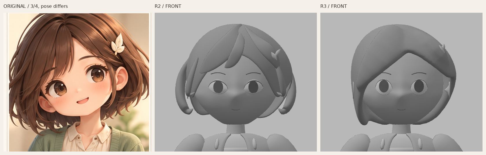
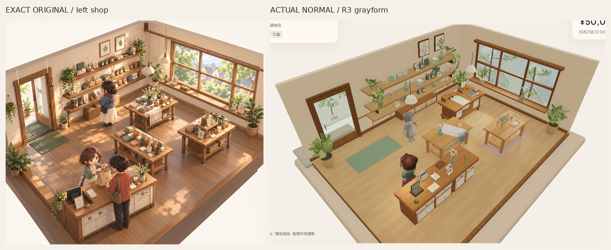

# Misaki R3 — 主瀏海髮量／較飽滿眼口，未獲identity PASS

Source `7b0d20fd91f537a43244a51c64afe64a1b7ec425`，仍只在`codex/asset-foundation-v1`。R2獨立頭頸identity gate仍FAIL，本輪只修髮量與眼口，**R3尚未獲風格／身份接受**。連續頰顎／鼻額、耳頸空隙與衣身保留；不做衣服、材質、rig／動畫或手指，不把3.24頭高當規格。

[三分四面同組對照](reviews/evidence/misaki-grayform-v1-r3/original-r2-r3-threequarter-head480.png)／[側面同組對照（側面推定；原圖面板仍為三分四）](reviews/evidence/misaki-grayform-v1-r3/original-r2-r3-side-head480.png)。模型R2／R3用同一相機、相同原始裁切與等比縮放；原頭像以冠至下顎近似匹配頭尺度，原姿勢不同，沒有把它冒充正交側圖。僅裁切／縮放／排列／標籤，沒有修色或重畫像素。[唯一原圖](codex-v4/reference/Approved_Visual_Target_Misaki.png)仍1536×1024、SHA256`9f855d2ecfd120bb45c001db3fa9b5a3e3b58b2b3c2a4cf9e7ebfda84f8f7114`，本輪再次看實際原頭像像素；PlanB未看、無新下載重試。

## 真正改動

- 髮量由冠頂分離厚片／接近對稱C尾，改為偏側根部分界、一個主導斜瀏海及較小的另一側分面；較小一側留出角色自身左耳／髮夾，兩側及後緣不等長。這是實際厚量體，並非貼在頭上的曲面卡。
- 可編輯來源包含基礎bob、主瀏海與較小側分三個體積cage及各自vertex group；合成連續曲面保留根部厚度。髮量仍同一級subdivision，沒有新增細髮；合成後的髮mesh限制約8,000tri，保留可回改的來源控制面，不用更多三角面假裝鬆軟。
- 眼口半寬42→37mm，中央上下開口31／22→36／27.5mm，外角傾斜4→2.5mm；上瞼折面寬6→3mm、上緣線徑亦減薄。實際眼孔後仍是曲眼面與簡單灰值iris幾何，沒有iris貼圖。頰顎／鼻額profile函數、頸與耳cage、頭頸offset全部與R2相同；眼孔仍兩圈各40條細分後邊。
- 髮夾保留自身左+X的葉形，以剛體切線方向貼向實際髮面，沒有逐點扭成投影形狀。156個clip頂點到髮面的unsigned距離約1.25–11.78mm，屬初步附著／翹起葉端資料，**並非完整接觸或collision通過**。

**自檢仍有實際不足：主瀏海和較小側面仍偏厚，合成表面的轉折有不夠自然的地方；後腦仍過於整齊，眼神也仍泛通用人偶。** 這組可看主從髮量和眼口變化，不能宣稱已達原圖的鬆軟感或Misaki身份。下一步仍是頭髮中等曲率／前後體積與眼瞼形狀的獨立判斷，未獲接受前不轉去衣服、細髮、貼圖或動畫。

## 同尺度全身與真正遊戲鏡頭

[正面全身R2→R3同尺度](reviews/evidence/misaki-grayform-v1-r3/r2-r3-front-body-same-scale480.png)／[三分四全身](reviews/evidence/misaki-grayform-v1-r3/r2-r3-threequarter-body-same-scale480.png)／[側面全身](reviews/evidence/misaki-grayform-v1-r3/r2-r3-side-body-same-scale480.png)。同720×900原viewport及正交camera bounds，身體沒有縮放；固定key2.1／fill.65、camera/light TS原檔與七個灰材質定義逐byte保留。只更新作者HTML的R3標籤。

[R2→R3正常480px](reviews/evidence/misaki-grayform-v1-r3/r2-r3-normal-shop480.png)／[正常完整PNG](reviews/evidence/misaki-grayform-v1-r3/grayform-game-normal.png)／[左斜角](reviews/evidence/misaki-grayform-v1-r3/grayform-game-oblique-left.png)／[右斜角](reviews/evidence/misaki-grayform-v1-r3/grayform-game-oblique-right.png)。新灰模仍在`[.85,.079,1.35]`、yawπ；正常camera與全燈同R2，斜角只alpha±.24，沒有zoom。原彩色staff／rig／行為／資料不替換，新灰模仍僅DEV靜態作者樣件，普通`/`不載入。

[完整正面](reviews/evidence/misaki-grayform-v1-r3/grayform-front.png)／[三分四面](reviews/evidence/misaki-grayform-v1-r3/grayform-threequarter.png)／[側面](reviews/evidence/misaki-grayform-v1-r3/grayform-side.png)／[背面（推定）](reviews/evidence/misaki-grayform-v1-r3/grayform-back.png)。舊背景／衣身仍是凍結內容，不當這次頭髮成果。

## 來源及實際檢查

[Blender](../assets/authoring/misaki-grayform-v1/misaki-grayform.blend)／[GLB](../public/assets/misaki-grayform-v1/misaki-grayform.glb)／[R3作者碼](../tools/asset-foundation/misaki-head-neck-r3.py)／[重建說明](../tools/asset-foundation/MISAKI_GRAY_README.md)／[摘要](reviews/evidence/misaki-grayform-v1-r3/summary.json)／[原始capture](reviews/evidence/misaki-grayform-v1-r3/capture.json)。

- 49,414tri，比R2少4,066；5meshes／10primitives／7原灰材質、902,632bytes，零images／skins／animations，新GLB零error／warning。作者場景共121,110tri，不bulk複製，不當裝置效能已過。
- clothed-body全12組POSITION／NORMAL／index streams及nodeTRS逐byte同source`038740fbd7f6428cc82d5f442646c2d86a4143e3`，七個灰材質定義相同。R2頰顎鼻額profile與頸耳cage定義相同；29個R4／PaperR2檔及720原application保護檔相同。feetY0，左夾+X；頸頭縱bounds重疊58.38mm／chin至凍結衣物頂35.18mm保留。
- 本輪Blender4.3.2、glTF／來源scope／body-byte／材質／原點／凍結檢查、read-only眼孔頸位與clip距離、strict作者TS及finalbuild；source、dist、studio及game實載GLB SHA一致。[asset驗證](reviews/evidence/misaki-grayform-v1-r3/asset-validation.json)／[來源檢查](reviews/evidence/misaki-grayform-v1-r3/source-inspection.json)。
- fresh Sandbox真UI買3杯5000→4790／stock3／未改display3槽2上架／reload逐值同／Low→High／隔離Normal不變，0pageerror。前302tests等未重跑，這次新驗證不等於完整舊角色動作／physicalGPU-FPS-audio-native、watertight皮膚、完整碰撞或身份接受。

原生Library同一正常image更新至**version2**：`libfile_0224bad58e5881918df7c73f50e81481`，`grayform-game-normal.png`，file ID`file_000000008f0c8211ac36409628159317`，641,830bytes；R2第1版／首版0保留。

PlanB仍停止：初次與唯一fresh consumer-local retry兩次官方helper皆exit1、`library file transfer failed: download failed`，兩個目的地無ZIP、無新圖／本機SHA；原因未明，非審批拒絕。[原精確失敗紀錄](reviews/evidence/misaki-grayform-v1-r3/reference-access.json)原樣保留，本輪沒有新嘗試。只推隔離分支；無PRretry、main／PR8寫入、merge、Site公開、payments或玩家Normal變更。除PlanB參考比對未完成外，無其他操作阻塞。
