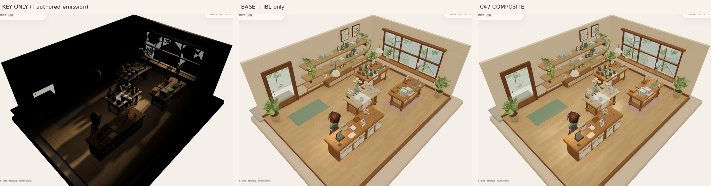
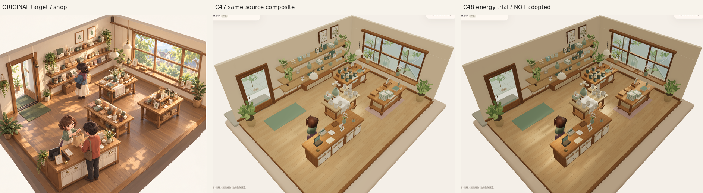
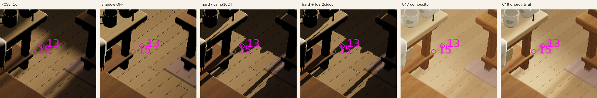

# V11 C48 — 固定 C47 光源貢獻與葉影診斷

應用來源：`8091d04ba67256d9f19e69363efeacfa219b8452`。這是作者診斷，不是美術接受或發佈候選；普通無旗標仍為已接受的 C45 contact，公開 V17 本輪沒有改動。

## 結果與下一判斷

實際 key-only 圖有窗洞及葉片陰影。base+IBL-only 已接近 composite 的整體亮度；目前方向光的明暗被其他光源貢獻壓低。兩個已知葉片第一 caster 的地板接收點，影圖深度、硬陰影對照及實際像素一致支持「葉影存在」，不支持在這些點以缺少 caster、背面剔除或入口裁切解釋失影。

只做了一組獲授權的能量重配：key ×2、兩個室內半球光 ×.70、全局 IBL ×.80。收銀／中央實用燈、面部補光及室外光保留。方向亮區較明顯，但牆面及收銀變暗，與原圖的柔亮、自然陰影和材質層次仍有明顯距離，**未採用、未判視覺 PASS**。不再掃描方向，也沒有加葉片、假光斑、AO 或更動模型／材質。

原圖是既有 `Approved_Visual_Target_Misaki.png` 左側店鋪區，SHA256 `9f855d2ecfd120bb45c001db3fa9b5a3e3b58b2b3c2a4cf9e7ebfda84f8f7114`；另兩張是本來源實際遊戲畫面。比較圖只是縮放、排列和標籤，沒有美化、重繪或替換可玩場景。靜止店鋪沒有顧客不構成本輪美術判斷的缺陷。

## 控制與實際光量

八組均來自上述應用來源，實際 UI 進入獨立 Sandbox、匯入相同 8-stock QA 種子、High、同正常 camera／經濟值，七個診斷組使用 Reduce Motion。所有圖均為 1440×1200 雲端 Chromium／SwiftShader 實際 WebGL 截圖；原圖不是遊戲截圖。

|build|控制|key|室內半球 .27 / .85|全局 IBL|說明|
|---|---|---:|---|---:|---|
|308|key-only|110000|停用|0|其餘光停用；既有 authored emission／unlit sky 不變|
|309|base+IBL-only|停用|.27 / .85|1|七個非 key 光保留|
|310|composite|110000|.27 / .85|1|固定 C47 原設定|
|311|balance|220000|.189 / .595|.8|唯一能量試驗，非預設|
|312|key、shadow OFF|110000|停用|0|另標示的陰影控制|
|313|key、hard filter|110000|停用|0|同 1024 影圖，讀回 HALF_FLOAT texels|
|314|key、hard、leaf 2-sided|110000|停用|0|只改 shadow-pass 材質，檢驗背面假設|
|315|ordinary no flags|C45|C45|C45|實際頁面嚴格核對 C45，作者控制停用|

前三組只分離光源，方向、曝光、幾何、材質、反射、AO、shadow recipe 相同。balance 除表列三項權重外，保留 practical cashier 20／central 24、face .43、exterior sun 2.8／sky 1.25。材質自身 emission 沒有被算作 key 的貢獻；接收點地板為無 emission 的 opaque PBR。17 styling 群、.20 AO、192 reflection、既有資產與接受的構圖均保留。

## 已知葉影接收點與 filtering

|接收點|世界座標|DOM 像素|第一 caster|影圖 sample / receiver depth|硬陰影 factor|
|---|---|---|---|---|---:|
|13|[-1.217,.079,-.333]|[868.65,601.39]|native.window.foliage.5.material0|.257568359375 / .319221907394|.12|
|15|[-1.021,.079,-.333]|[856.84,609.86]|同上|.257568359375 / .321561722629|.12|

實際 camera ray 命中地板，light ray 的第一個 renderList caster 是同一葉片，四個 portal clip 距離均在保留側。硬陰影 RTT 實際 `readPixels` 回傳 Uint16 HALF_FLOAT：13343 解碼為 .257568359375；依 pinned Babylon 8.32.0 shader 的 depth metric／compare 得 .12。這是指定兩點的實際軟體 WebGL 影圖資料，加上 CPU ray 與畫面交叉核對；不是全場景 GPU 完成或物理量測認證，也不是由 tone-mapped RGB 反推精確 PCSS factor。

|控制|13 RGB|15 RGB|
|---|---|---|
|key PCSS|53,39,23|123,93,57|
|shadow OFF|163,129,84|164,131,85|
|hard|39,28,17|39,29,17|
|hard＋leaf 2-sided|39,28,17|39,29,17|
|composite|189,158,110|199,169,123|
|balance|171,139,94|196,167,122|

PCSS 保留較柔的影邊；hard 及雙面 hard 的指定點相同。八個葉片 shadow-pass override 的實際 render hook 已確認 backFaceCulling=false，camera 材質不動。這個控制沒有帶來修正，未採用。完整 UV／raw bits／light matrix／render IDs／shader hashes 及公式在證據目錄內。

**早期診斷錯誤已隔離：**初版 marker 把 GL viewport.y=104 當成 DOM top，正確 top 應為 88，造成 16px 偏移。兩張錯誤標記圖及其像素推論明確作廢，保留於 `invalid-early-marker/`；本報告所有點／RGB 及最終 308–315 圖均使用修正後投影，並有非對稱 viewport 單元測試。這不是遊戲 camera 的更動。

## 全圖取捨、自檢與來源

固定非焦點 ROI 的 display luma（非物理 luminance）composite→balance：左牆 170.87→147.33、入口地板 162.96→152.11、收銀桌面 129.48→110.79。入口及工作區仍可讀，但變暗取捨可見，不能把較強光帶等同原圖氣氛。下一判斷應根據這套來源分離與全圖比較，不再把陰影不存在當前提；本輪不再疊加無對照調參。

- 295 tests；tsc／各 variant build／validate／replay／asset-check 通過。
- 146 GLB 零錯誤／警告；305 protected files；512 資產 exporter 重建 byte 同；317 原模型／貼圖／反射 bytes 及既有 environment geometry/presentation/extensions 保留（只有新增作者診斷 metadata）。
- 八組各 195 runtime payload hashes 已記錄，全部應用來源同一 SHA；eight actual pages 無 pageerror，camera／經濟狀態一致，fresh 隔離 Normal baseline 不變。沒有存取或更改玩家 Normal。
- 本輪是 High 靜態光源診斷，**沒有新增 stock-cycle、Low、完整 handoff／B transaction／連續動作／hidden-tab／五語窄屏認證**；C47 舊覆蓋不改標為 C48。沒有物理 GPU／FPS／audio／native 認證。
- PR8 保留 Draft；沒有 merge、Site save/deploy、使用者 Chrome／Unity、Library 或 LTC 重試、關機。無需使用者動作的阻塞；整體原圖品質／風格依然未接受。

完整原始截圖、gzip diagnostics、影圖讀回、runtime payload、素材保留／重建清單、檢查 logs 及媒體 SHA 位於 [C48 evidence](../evidence/native-v11/checkpoint-48-source-contributions/README.md)。
