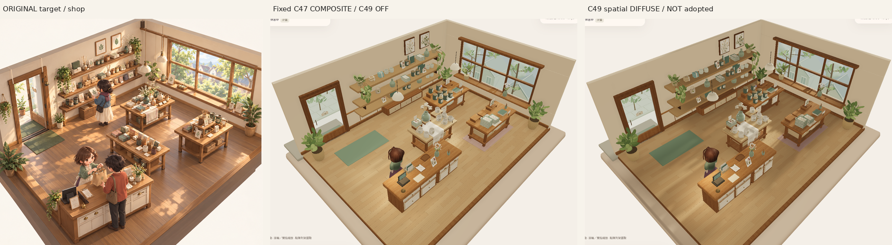
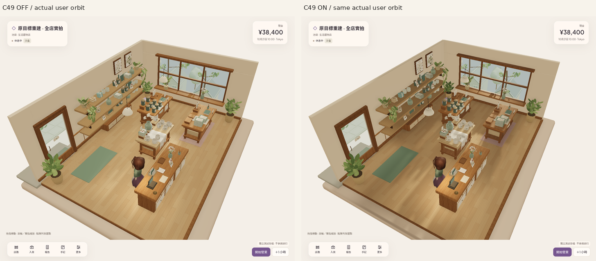
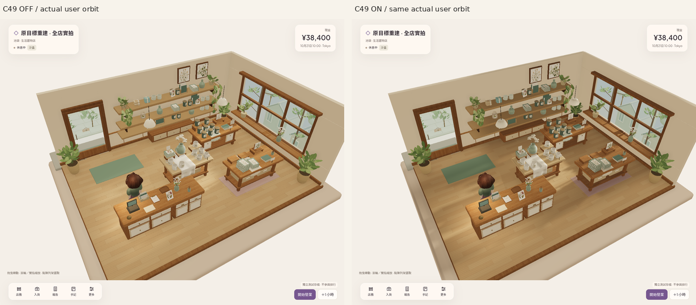

# V11 C49 — 單一世界空間漫射補光試驗

Application：`82014abaf0be78e0cf1859236b82b9d90bd44f8a`。固定 C47 窗光方向、光量及陰影，**只測一組 spatial diffuse 候選，未採用、未判視覺 PASS**。普通無旗標仍 C45；整體原圖品質／風格仍未接受，公開 V17 未改。

## 方法與不變項

`src/art/spatial-diffuse-v11.ts` 使用 Babylon8.32 公開 MaterialPluginBase：精確命中兩個半球光的 `computeHemisphericDiffuseLighting` 後乘世界空間權重，另乘 diffuse `finalIrradiance`；不乘 direct key／point diffuse、`finalSpecular` 或 IBL `finalRadiance`。現有陶瓷反射、clearcoat、材質 environmentIntensity、全局 IBL intensity 與 192 reflection bytes 保留。這是作者設計的平滑間接漫射近似，**不是 GI、光線追蹤或實際能量傳輸計算**。

權重只依世界位置及世界表面法線：朝上面從均勻底光減至最低 .48；背牆垂直面維持 1，收銀中心 [2.6,-1.5] 以半徑 [1.65,1.4] 的平滑區域恢復到 1，後架與入口亦有寬緩保留區。補償是保留既有暖漫射，沒有增加 emissive／假陰影／螢幕光斑、貼圖或幾何。場外與垂直面平滑回原值。CPU 權重只用於測試及診斷；實際 shader 使用 `vPositionW`、`normalW`。

固定 key110000、residual .85、exposure、PCSS／.16 shadow softness、.20AO、接受的模型／構圖／素材與 reflection192。不掃方向、不加葉片、不再試第二組參數。實際 floor／central display／counter 三個接收材質均編譯出兩個 hemisphere hook、一個 diffuse IBL hook，沒有 specular field modification；Low／High 與 reload 後均確認。

## 實際畫面與取捨

|固定正常畫面 ROI|composite display luma|C49|變化|
|---|---:|---:|---:|
|左背牆|170.87|170.87|0.00%|
|收銀桌面|129.37|128.44|−0.72%|
|入口地板|162.98|135.14|−17.08%|

ROI 座標、RGB 均值與計算在 `source-identity.json`；這些是 tone-mapped display 數值，**不是線性能量百分比**。方案避開 C48 全局重配時牆面／收銀約14%的降幅，中央地板方向差異較可讀。但入口地板降幅更大，原圖柔亮的窗側→中央→收銀層次與自然葉影形狀仍未建立，不能把較深地板或局部對比視為目標達成。兩個實際相同 pointer orbit 角度未見跟鏡頭移動的貼片光；不代表所有相機／移動人物狀態皆已認證。保留 OFF 對照交獨立看圖。

三張對照只裁切／等比縮放／排列／標籤；raw PNG 是正常 shop camera 的實際可玩 WebGL，並非 Zen 替身、studio 或生成概念圖。正常 raw3D 截圖部分沒有 DOM 合成層，當時實際 DOM 的 HUD 為 visible／opacity1，body 無 Zen class；這是捕圖限制，不能當成 UI 自動淡出或正常 DOM 合成通過。兩個實際斜角有 HUD，正常 cameraPose 與經濟皆相同；未用 CSS 隱藏或注入相機／人物。唯一原圖仍是既有 `Approved_Visual_Target_Misaki.png`（SHA256 `9f855d2ecfd120bb45c001db3fa9b5a3e3b58b2b3c2a4cf9e7ebfda84f8f7114`）的左店鋪區。

## 來源與驗證

- 317 composite（C49 OFF）、318 spatial（ON）、319 ordinary（全無旗標）來自同一 application，每組195 runtime SHA已記錄。控制／候選相機、兩斜角、8-stock經濟與 key/shadow 設定相同。ordinary 實際嚴格核對 C45，C49/C48均 OFF。
- 300 tests／tsc-build／validate五語174keys／replay／asset-check 通過；146GLB零錯警告；305保護檔／原11歷史與路徑保留；508資產重建 byte 同，284 GLB/PNG/JPG/ENV/RGBA原檔及環境母檔完全不變。只更新原角色manifest內的 world source hash，沒有重做已過資產。
- 實際 High+Reduce Motion 的正常／雙斜角、Low→High切換通過；Low移除AO buffers、High恢復 .20，兩級shader保留漫射分離。沒有 GPU 資源釋放或完成畫格認證。
- 新鮮隔離 Sandbox 真 UI 買1杯，帳本 cash3840→3770、stock8→9、purchases／bookCost各+70，shelves不變；reload逐值save相同，實際3D與插件恢復，fresh隔離Normal baseline不變，0pageerror。金額是既有內部帳本單位，畫面JPY為¥38,400→¥37,700。此例不是新完整stock cycle或結算／handoff／B交易。
- 原始 orbit 片對照29來源幀／53.399s、候選27幀／53.627s；買入reload片21幀／45.105s。最大來源間隔分別2.143／5.569／4.858s，都是稀疏軟體渲染證據，非連續流暢度、實體GPU／FPS／audio／native或hidden-tab認證。沒有新增五語窄UI驗收。
- 初次材質生命週期測試與過期manifest hash檢查曾失敗，已修正 pre-render enrollment／dispose清理並重建manifest；最終300通過。首輪QA等錯舊C43 AO ID已取消／不計PASS，helper改為準確C44及實際Low/High後重跑；renderer沒有因此改參數。最終QA helper hash已pin，C48歷史receipt仍綁原application，C49新receipt綁現行shader/config，沒有放寬斷言。

[完整原圖來源、raw PNG／diagnostics、三組payload、shader配置receipt、素材保留／重建／logs及稀疏原片](../evidence/native-v11/checkpoint-49-spatial-diffuse/README.md)。沒有 merge／Site save-deploy／玩家Normal／Chrome／Unity／Library或LTC重試／關機；無需使用者動作的阻塞。下一步先覆核這個固定試驗的全圖取捨，再決定原圖重建的下一個有效方法，不擴展資產或盲調更多光量。
