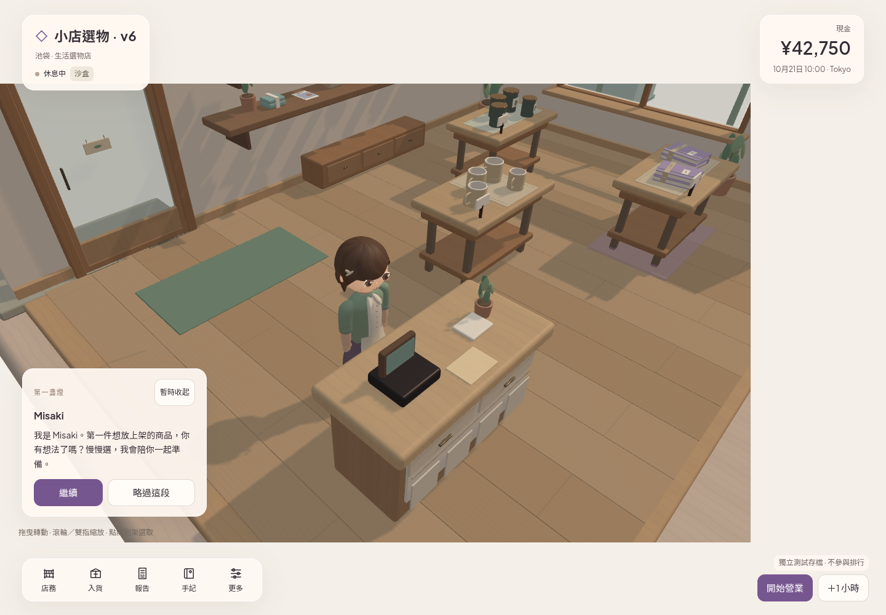
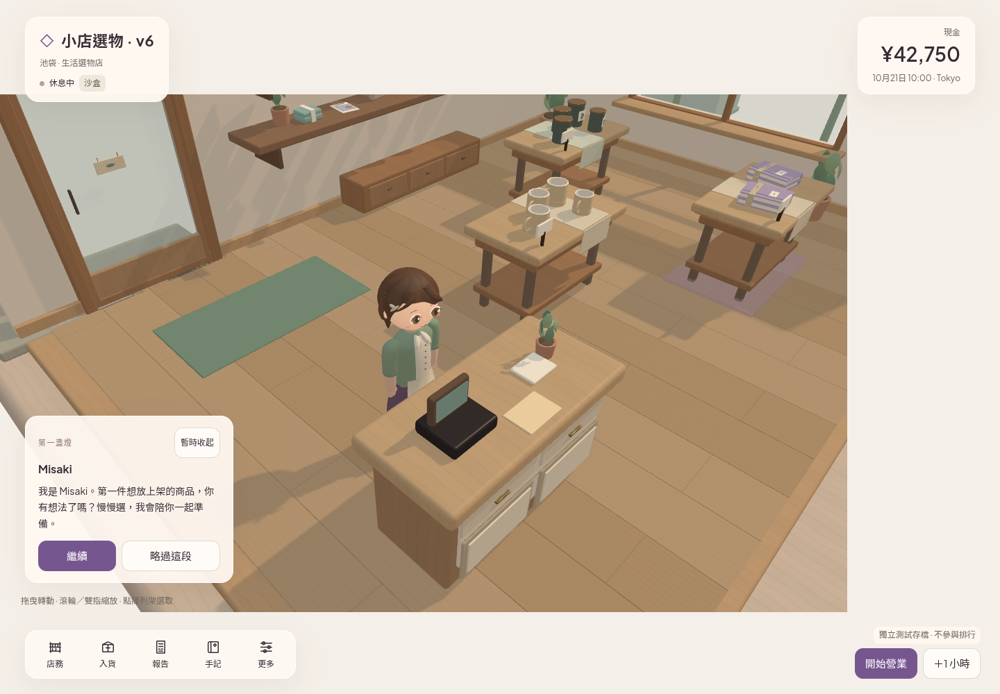

# V8 art and pricing — review handoff

[Draft PR #5](https://github.com/wizardkeith/KeEv-games/pull/5), branch `codex/game-v8-art-pricing`. Baseline is published V14 source `6019bf287d061bd090d2b07c73e31a984c74b241` / receipt main `208c4452148e235bff1d3bd580b55a84a1a09bbc`. Final runtime **ac134fd5dec19f64aa00e0b4441e3006f07c8a0b**, `src` tree **6b0e747182b5b2ad498e27d23fec0ffc3478a244**. Later delivery commits change evidence/documentation only. **No merge or publication**; parent arranges independent review. Story, gameplay, new shops and sets remain frozen.

## Pricing presentation

Operations now uses one vertical table/list row per existing shelf slot. Desktop columns align item/icon, inventory, current/suggested price, editable JPY draft and existing actions. Narrow screens wrap labeled fields into continuous rows; no carousel, horizontal overflow or nested row scroller. Empty slots still lead to stock; select, remove, restock, placement and cancel remain available. All targets retain 44px sizing; save remains focusable while busy and reports real completion/errors in its row.

The price formula/range is unchanged: displayed JPY divided by ten, integer core units 1–100000. `capturePrice` freezes the intent before an asynchronous write. Matching drafts clear after commit; a newer edit made while saving survives. Repeated activation/cancel during busy is ignored, aborted storage preserves the snapshot/draft, and correcting an invalid input clears its stale error without replacing the input node. Leading zeros, session/mode separation and reload remain supported. There is no default-price, economic-balance, catalog or save-schema change.

## Focused playable 3D pass

The established target remains authoritative. The owner's reattachment is not a changed visual brief. Actual approved repo PNG and Bible reference pixels were inspected before art work. Main visible gaps were heavy forehead coverage, round sparse foliage, plain counter/runner surfaces and flat room shading.

- Sculpted asymmetric fringe and two integrated temple sweeps expose the face; larger flatter eyes, warmer iris/skin and restrained hair-normal strength improve readability. Apron hem/folds are smoother. Tiny button geometry was simplified to fund visible locks: Misaki **11816 triangles**, below the existing 12000 cap and prior 11968. Articulations, identity, grounded feet and pose clearance remain tested.
- New closed curved leaf geometry replaces oval foliage and printed leaves; seven existing sway attachments carry fuller blades or small counter blooms. No new item, actor or gameplay fixture was introduced. Counter cabinet frames/insets, warm handles and true draped table runners add material/silhouette separation. Shelf product yaw/scale is curated within existing layout and true stock-sample limits.
- Warmer ground bounce, restrained pendant emission and contact-hardening High shadows improve cohesion. Exposure stays 1; Low retains 1024 PCF shadows, basic motion and Minimal/Reduce Motion behavior. High uses a 2048 shadow map. No backdrop image, generated mockup, new point-light array, bloom or exposure boost substitutes for playable geometry.

This is a visible refinement, **not final target-art acceptance**. Organic hair/cloth surface detail, environment richness and overall naturalness remain simpler than the approved image. Keep visual work ahead of content expansion.

## Fresh checks

- **150 tests, 0 failures/skips**; TypeScript/Vite build, content validation, deterministic replay and asset-check pass. Replay cash 5020 / stock 4 / net 180 / units 6. Existing large-chunk warning remains.
- Five exporters rerun: **212 tracked asset/public files** are byte-identical before/after rebuild. All **55 public GLBs** validate with 0 errors/warnings. Original accepted W1.1B masters remain byte-identical; current reusable source/GLB masters and complete history are retained. New foliage geometry has finite unit normals; original fixed scene/actor budgets and pose/skin/clothing tests remain intact.
- **111 protected files** match V14: core/platform/content/narrative/source inputs/hosting/package, all procedural presentation motion and accepted stock list/state/copy/session drafts. No story predicate, SKU, layout, economy or transactional save change.
- Pricing production WebGL: aligned desktop rows and empty slots; all five drawers 580px with exact camera pose retained; panels/reload/leading-zero draft, Tab/Enter focus, invalid/cancel, delayed/repeated writes, newer pending draft and actual transaction abort/recovery pass. Existing remove/restock/placement actions pass. **20 five-locale 320/375 × 420/812 touch price saves** retain stock/book cost/cash and isolated Normal, with 44px targets, zero horizontal/nested scrolling and zero page errors. Reduced-motion draft retention passes.
- Accepted stock-list regression independently rerun on this iteration: **20 five-locale short/narrow touch buy/place cases**, selection/vase `007`, filter/query/per-view positions/panels/reload, keyboard focus, repeated/delayed/aborted writes, native vertical wheel, reduced motion and unchanged isolated Normal pass. The final subsequent edit only clears pricing-input feedback; stock/render components are unchanged.
- Genuine prior-v5 QA Sandbox export imported/reloaded with 18 protected snapshot fields preserved, then supports a real purchase **and a price edit through the new row UI**. No player's Normal save was used.
- Delivery: **121 runtime files + hosting = 122 archive entries**, each opened and compared with the build. Archive metadata/hash is in [delivery receipt](../evidence/native-v8/delivery/receipt.json); evidence is excluded from the runtime archive.

## Render evidence and limits

| V14 baseline | V8 candidate |
| --- | --- |
|  |  |

[Before](../evidence/native-v8/browser/before/) / [after](../evidence/native-v8/browser/after/) include normal shop panorama and character/counter view. Both use High plus Reduce Motion for comparable neutral poses; the identical QA shop name is test data rather than a release version; the actual camera pose is identical. [Pricing screenshots/uncut interaction](../evidence/native-v8/browser/pricing/) show the row UI at desktop and all narrow locale cases. [26-second continuous motion excerpt](../evidence/native-v8/browser/movement-work-purchase-uncut-26s.webm) and retained [58.84-second original](../evidence/native-v8/browser/movement-work-purchase-full.webm) show actual Low + Minimal customer/staff activity and one real purchase. The excerpt is one chronological section, with no cuts or synthetic frames. Chronological actual frames were inspected; encoded FPS is not physical game FPS.

All evidence is Chromium/ANGLE SwiftShader software WebGL. An initial simultaneous-context recording exceeded its startup wait; closing the still-image context before the fresh motion context resolved capture load. No application workaround or rendering hook was added. Physical GPU/FPS/startup/Safari/mobile keyboard/safe area/audio/true hidden-tab/native Unity/C#/URP and final-art acceptance remain open. No local PC/Unity operation or public-proxy retry/bypass occurred. Same existing Site/URL is reserved for a separately authorized checked release.

Library reference `libfile_8331a41ec92c8191a12e7a908c4d770a` resolves to `06-approved-target-browser.jpg` (registry metadata 234489 bytes); supported download failed, so this executor did not inspect that attachment's bytes/pixels. The owner confirms the same prior reference; existing approved repo images support the independent work. A supported four-file output upload failed during tool discovery (`network`) before preparation/finalization. **No new Library IDs and no uncertain Library writes**; complete local evidence is committed here. See [Library status](../evidence/native-v8/library-status.json).
